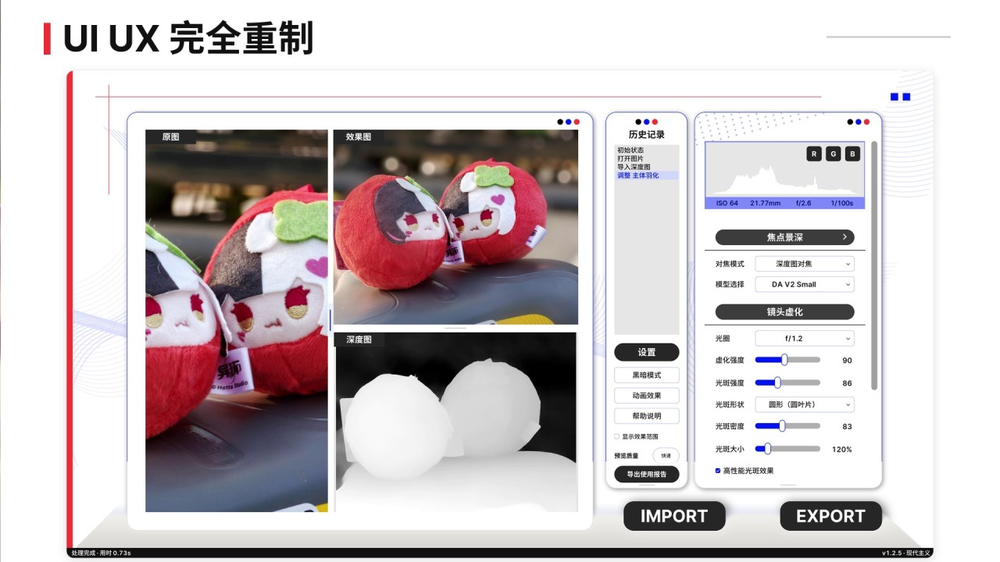
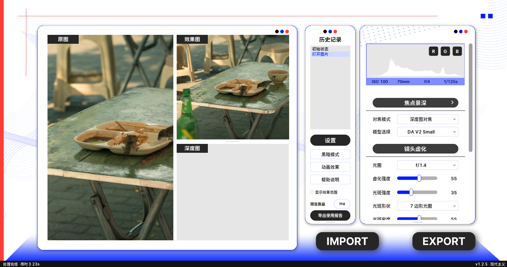

# Edmund Lumen Bokeh · 伯爵大光圈模拟

Windows 桌面景深模拟工具。导入照片后，可按中心距离、点击位置或深度图控制离焦，导出合成照片或可叠加到原图的透明效果图层。

**源码版本 1.2.5 · 现代主义**。本文说明当前源码。已有可执行文件的功能取决于其构建日期，版本差异见[更新日志](CHANGELOG.md)。

## 现代主义宣传片

[](https://github.com/KyMoShI/edmund-lumen-bokeh/releases/download/v1.2.5/edmund-lumen-bokeh-v1.2.5-promo-landscape.mp4)

横屏宣传片 · 1920 × 1080 · 32 秒。[打开或下载原片](https://github.com/KyMoShI/edmund-lumen-bokeh/releases/download/v1.2.5/edmund-lumen-bokeh-v1.2.5-promo-landscape.mp4)



## 快速启动

1. 源码版使用 Windows 10/11 64 位与 Python 3.10–3.12，项目发布构建使用 Python 3.11。解压项目后双击 `run_windows.bat`。脚本创建或复用 `.venv`，基础依赖缺失时联网安装。目录版可执行文件需保留同目录的 `_internal`。
2. 欢迎页选择 `START`（开始） 进入空白工作区，或选择 `NEXT`（继续） 恢复上次会话。点击 `IMPORT`（导入） 或拖入 PNG、JPEG、BMP、TIFF、WebP 图片。程序支持中文路径，并按 EXIF 方向显示照片。
3. 在「焦点景深」中选择对焦方式，再在下方的「镜头虚化」中设置光圈和虚化强度。预览满意后点击 `EXPORT`（导出）。
4. 导出完成页显示实际文件地址，可选择、复制或点击定位。`NEXT`（继续） 或 Esc 返回编辑，保留参数和操作历史。`EXIT`（退出） 返回欢迎页。

基础渲染使用 CPU。中心对焦、点击对焦和导入深度图均可离线使用。若现有 `.venv` 引用的 Python 已移除，可先备份或重命名该目录，再使用已安装的 Python 重建。手动启动命令如下。

```powershell
python -m venv .venv
.\.venv\Scripts\python.exe -m pip install -r requirements.txt
.\.venv\Scripts\python.exe app\main.py
```

## 操作说明

| 工作区 | 操作 |
| --- | --- |
| 预览区 | 左侧为原图，右侧为效果图和深度图。浅色模式用滚轮缩放、中键平移、双击适应窗口。拖动分隔条调整左右或上下比例，双击分隔条或按 Home 恢复该轴默认比例。 |
| 历史与设置 | 点击历史条目跳回相应状态。中栏「设置」菜单提供显示原图、撤销、恢复、直方图及返回欢迎页。勾选「显示效果范围」可用红色标记检查变化区域，仅影响预览。 |
| 焦点景深 | 点击标题展开模型导入、推理分辨率、焦点深度、景深分离、深度图读写及主体边缘控制。AI 估算或导入灰度深度图后，可点击预览重新指定焦平面。 |
| 镜头虚化 | 可直接设置光圈、虚化强度、光斑强度、形状、密度、大小、球差、猫眼压缩和高光补偿。启用「高性能光斑效果」后可使用扩展范围。 |
| 卡片与窗口 | 拖动右侧两张卡片的底边分别调整高度，双击恢复自动高度。点击预览或控制卡片右上角的浮动按钮可独立移动和缩放，关闭或选择「恢复原位」归位。黑夜模式支持按标题拖动排序。 |
| 动画 | 中栏「动画效果」可设置总开关、速度、更新频率、标题打字、卡片倾斜及空画布鸟群。滚轮滚动逐渐减速，触控板按位移跟随。空画布中的粒子随鼠标聚集，鼠标离开后向随机目标迁徙。 |

**直方图。** 参数卡片顶部以浅灰底、白色柱条表示 256 档频数。右上角 R、G、B 分别选择红、绿、蓝通道，点击已选通道返回亮度统计。切换「显示原图」会切换统计来源，效果范围标记不计入统计。下方显示 ISO、焦距、光圈和曝光时间，缺少拍摄信息时显示尺寸和格式。空图时统计区域与信息条留空，通道按钮禁用。黑夜卡片与独立窗口共享同一通道。

**会话。** 返回欢迎页或正常关闭编辑器时保存图片路径、深度数据和参数。进程内恢复保留历史，重新启动后以恢复状态作为历史起点。若原图缺失，仅恢复可用设置。原图大小或修改时间发生变化时，程序重新读取原图并丢弃旧深度。主题、动画、卡片布局及参数偏好写入 `settings.ini`。

| 快捷操作 | 按键 |
| --- | --- |
| 打开图片 / 导出效果图 | Ctrl+O / Ctrl+Shift+S |
| 撤销 / 恢复 | Ctrl+Z / Ctrl+Y 或 Ctrl+Shift+Z |
| 黑夜模式缩放 / 平移 | Ctrl+滚轮 / Ctrl+中键拖动 |
| 浅色预览视图菜单 | 右键，支持适应窗口、预览像素 1:1 及重置视图 |

## 光斑渲染

普通模式使用三档光圈形状的点扩散函数（PSF）卷积背景，并单独绘制局部高光。高性能模式在线性光空间按焦前、焦后和视场位置插值宽谱 PSF，将连续纹理、局部反光和扩展光源的贡献一起合成。球差改变光斑中心与边缘的能量分布，猫眼压缩影响视场边缘的光斑形状。[模拟流程与核样本](docs/simulation-guide/README.md)

### 参数范围与精确输入

数值框支持键盘输入，按 Enter 提交。切回普通模式时暂存超出其范围的值，再次启用高性能模式可恢复。

| 参数 | 普通模式 | 高性能模式 |
| --- | --- | --- |
| 模拟光圈 | f/1.2、1.4、1.8、2.0、2.8、4.0、5.6、8.0 | 另增 f/0.95、1.0、11、16 |
| 光斑形状 | 圆形、5–9 边形 | 另增 3、4、10、12、16 边形 |
| 虚化强度 | 0–100 | 0–200 |
| 光斑强度、景深分离 | 0–100 | 0–250 |
| 光斑大小 | 30%–200% | 5%–600% |
| 光斑密度 | 0–100 | 0–200 |
| 球差 | −100 至 +100 | −200 至 +200 |
| 猫眼压缩 | 0–100 | 0–160 |
| 焦点深度、高光阈值 | 0–100，步长 0.1 | 同普通模式 |
| 主体边缘 | −100 至 +100 | 同普通模式 |
| 边缘羽化 | 0–100 | 同普通模式 |

- **反光控制。** 高性能模式的光斑大小按面积比例控制扩散，密度控制弱反光识别灵敏度。高光溢出补偿限制额外估算的光源亮度，普通模式则降低高光叠加的不透明度。
- **焦点控制。** 中心对焦时，焦点深度决定中心清晰半径。使用深度图时，焦点深度指定焦平面，景深分离调整深度差对应的虚化程度。
- **主体边界。** 保护清晰主体可减少焦点附近的模糊。主体边缘取负值时收缩保护区，取正值时扩张，边缘羽化控制过渡宽度。

## AI 深度估算

| 模型 | 源码版安装入口 | 首次下载参考大小 |
| --- | --- | --- |
| Depth Anything V2 Small / Base / Large | `install_ai_windows.bat` | 约 95 MB / 390 MB / 1.3 GB |
| DA3 Small / Base | `install_da3_windows.bat` | 约 131 MB / 480 MB |

在「焦点景深」选择模型并运行「AI 深度估算」。默认模型为 Depth Anything V2 Small。首次估算缺少权重时联网下载至 `models/`，后续复用本地缓存。也可导入兼容的本地模型目录或填写模型仓库地址。推理分辨率提供 518、756、1036、1260 像素四档，更改后在下次估算时生效。估算完成后按画面中部深度对焦，可点击预览微调。

程序将不同模型结果统一为近处数值较大。V2 采用最小值与最大值归一化，DA3 使用第 2 至第 98 百分位。导入深度图支持 8 位或 16 位灰度图，白近黑远。导出深度图采用原图尺寸，PNG、TIFF 为 16 位，JPEG 为 8 位。

发行工作流的 AI 构建安装 PyTorch 与 Transformers 依赖。DA3 还需要专用包及辅助依赖，源码安装脚本按相应顺序安装。更新源码环境中的依赖仅影响通过该环境启动的程序。

## 导出规格

当前打包前源码采用无边框主窗口；PS 联动原型已隔离至独立的 1.2.5 Git 分支。[分支目录与启动入口](docs/version-branches.md)

| 选项 | 取值与作用 |
| --- | --- |
| 合成效果图 | RGB PNG 或 JPEG，JPEG 质量 60–100 |
| 大光圈效果图层 | RGBA PNG，可按原尺寸叠加到原图上继续编辑 |
| 输出分辨率 | 原图的 100%、75%、50%、25%，设置窗口显示输出像素尺寸 |
| 光斑抗锯齿 | 普通模式的独立光斑层支持 1×、2×、3× 超采样。高性能模式使用波前核采样。 |

保存窗口优先推荐原图所在目录。该目录不可写时，程序探测其他可写位置。若手选路径无法写入，错误窗口保留路径和原因，可重新选择目录导出。使用报告可导出设备信息及本地事件日志，处理时间和参数记录在 `logs/app-YYYYMMDD.log`。

## 已知限制

- 单目相对深度在发丝、透明物体和遮挡边缘可能出现误差，可导入外部修订的深度图。模拟使用通用光瞳参数，过曝后丢失的光源细节只能有限估算。
- 高性能模式的背景计算最长边为 1000 像素，普通模式的独立高光层最长边为 5000 像素。焦内图像按所选导出尺寸合成。预览较慢时可降低「预览质量」，导出尺寸独立设置。[性能测量与条件](docs/修复记录.md#性能与回归)

## 构建与文档

Windows 离线安装版打开后可选择安装目录。安装程序将应用和运行库直接写入所选位置，无需预先安装 Python、Qt 或 AI 依赖。安装版随附用于离线深度估算的 Depth Anything V2 Small，其他模型可在程序内下载。

安装包使用完整目录版作为输入，可通过 `tools/build_installer.py` 制作。构建时使用 Windows .NET Framework 编译安装界面。安装目标须为新目录或空目录。

```powershell
.\.venv\Scripts\python.exe -m pip install pyinstaller
.\.venv\Scripts\python.exe tools\build_exe.py
```

默认输出 `dist\伯爵大光圈模拟\` 目录版。可选 `--onefile` 生成单文件版，或在已安装 AI 依赖的构建环境中使用 `--with-ai`。构建后可执行 `.\伯爵大光圈模拟.exe --selftest` 检查启动。[历史构建下载，提取码 1145](https://pan.baidu.com/s/1YCzmQz8v4SPe_HqDSKdQPQ)

[项目文档与发布流程](docs/README.md) · [界面设计规范](design-system/README.md) · [原图示例](docs/images/原图.jpg) · [效果示例](docs/images/模拟图.png)

代码使用 MIT 许可证。内置更纱黑体 SC 使用 SIL Open Font License 1.1。模型权重单独下载，使用条件以所选模型仓库为准。[项目许可证](LICENSE) · [字体许可证](app/assets/fonts/OFL.txt)

PS 联动实现暂只在本地开发分支保存；GitHub 的 feature/v1.2.5-photoshop 分支当前仅预留正式版基线，不包含联动实现源码。
