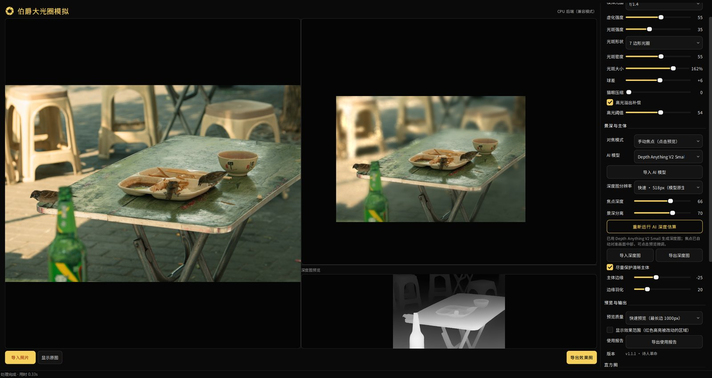
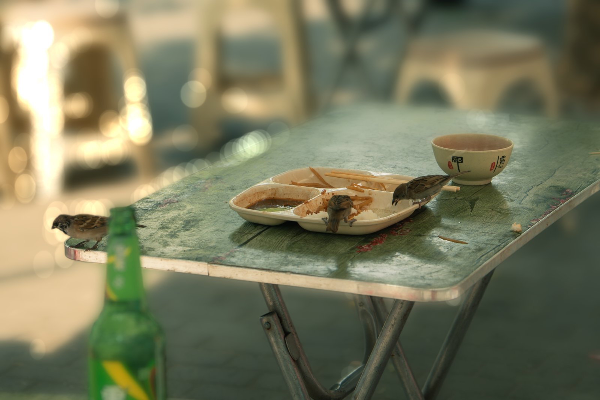
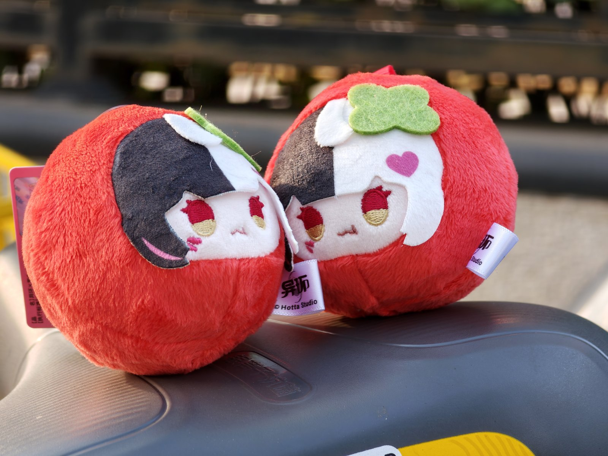
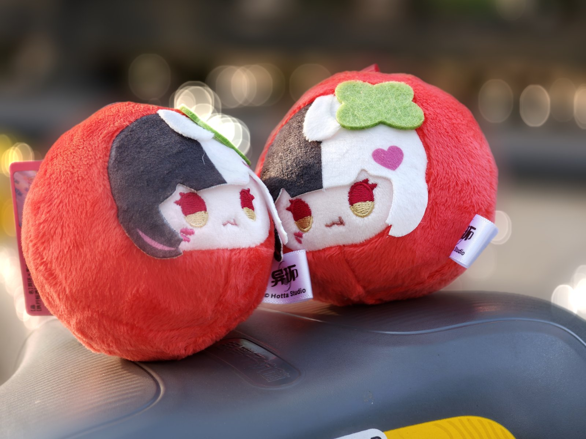
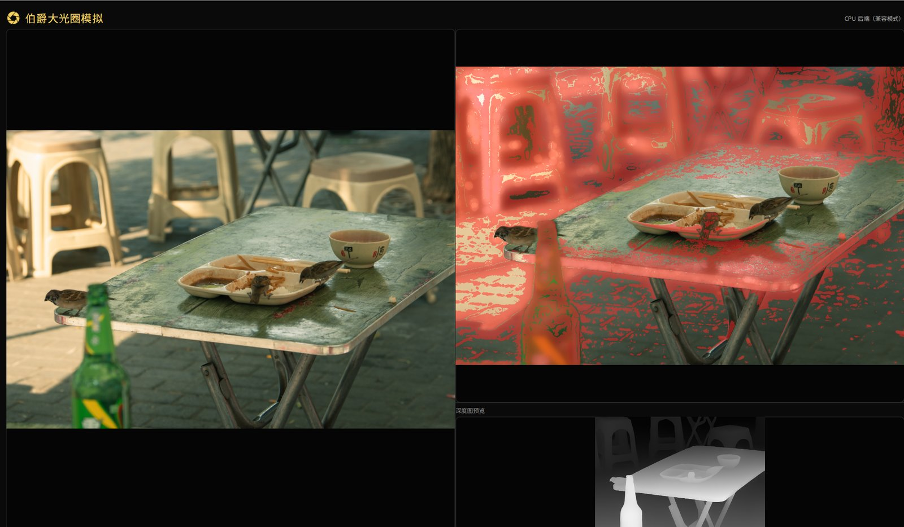

# Edmund Lumen Bokeh · 伯爵大光圈模拟 V1.1.1 诗人革命
## 该版本为正式版

Edmund Lumen Bokeh is a focused blur & bokeh simulator for Windows.





模拟效果示例1



模拟效果示例2


显示效果范围


## 当前功能

- 独立桌面窗口，支持 PNG/JPG/JPEG/BMP/TIFF/WebP
- 支持中文路径和中文文件名（读取走 Pillow，导出走 `imencode` + `tofile`）
- 自动应用 EXIF 方向，手机竖拍照片不会横着显示
- 左右对比原图与效果图
- 调整虚化强度、模拟光圈、Bokeh 光斑、光斑大小
- 中心对焦模式（无需 AI 模型），默认焦点在画面中部主体
- 手动焦点：点击预览中的任意位置，把焦点设到该处
- 可选 AI 深度估算（Depth Anything V2 Small / Base / Large），生成后自动把焦点对准画面中部
- AI 模型可导入：选本地 HF 格式模型文件夹直接使用，或填仓库 ID / 链接；本地没有时自动联网下载（hf-mirror → huggingface.co，支持断点续传），导入的模型会被记住
- 深度图可导入/导出：PNG/TIFF 为 16 位，JPEG 为 8 位，导出使用原图分辨率
- 背景虚化按真实相机的光圈 PSF 做卷积（圆形/多边形散景核），不再使用高斯模糊
- 右侧常驻深度图预览，导入或生成后立即刷新
- 光斑颜色参考背景环境色，避免白光源在彩色场景里始终是纯白；背景很暗时保留光源本色
- 光斑按圆角光圈多边形绘制，带柔边、亮边、猫眼压缩和偶发洋葱圈；背景光斑会被清晰主体遮挡
- 光斑按导出分辨率绘制（超大图封顶 5000px），边缘带柔化，不会因低分辨率放大产生锯齿
- 光斑按加性光强叠加，重叠处会更亮并混合颜色，而不是后画的光斑覆盖前面的
- 光斑形状可选圆形 / 5 / 6 / 7 / 8 / 9 边形，光斑大小与密度可调
- 散景支持「球差」调节：欠校正（正值）时光斑边缘形成亮环（肥皂泡感、硬朗），过校正（负值）时光斑中心发亮而边缘柔和；0 为校正良好、亮度均匀
- 散景「猫眼压缩」可调：0＝所有光斑都是正圆（默认），调大后模拟画面边缘的机械暗角把光斑横向压扁
- 圆形光圈的散景核与光斑都用解析圆生成，边缘不会出现多边形棱角（选 5–9 边形时刻意保留多边形轮廓）
- 背景模糊只采样背景像素，清晰主体的颜色不会抹进背景（消除全图模糊的光晕）
- 黄/黑/白配色界面，品牌黄统一为 `#F6D05D`（与 logo 同色），控件、字体、间距由 `app/theme/` 的设计令牌统一管理
- AI 深度会随导出缩放到输出分辨率，导出不会丢景深
- 导出可选取格式、分辨率、光斑抗锯齿和 JPEG 质量；支持透明大光圈效果图层（RGBA PNG）
- 预览调整做了 90 ms 防抖，拖动滑块不会堆积渲染任务
- 渲染在后台线程执行，全尺寸预览与导出期间界面保持响应，不再出现“未响应”
- 主体边缘可收缩/扩张并加羽化，用来缓解深度模型在轮廓处留下的一圈光晕
- AI 深度可选推理分辨率（518 / 756 / 1036 / 1260），在速度与边缘细节之间取舍
- 控制面板可滚动，控件再多也不会被窗口截断
- 全部设置连同窗口大小自动记忆在 `settings.ini`，下次打开自动继承
- 自动检测 OpenCV CUDA 可用性；当前虚化算子仍是 CPU 实现

## 环境要求

- Windows 10/11 64 位
- Python 3.10–3.12（推荐 3.11）
- 8 GB 以上内存；处理 24MP（约 6000×4000）图片建议 16 GB
- CUDA/RTX 并非必需。CPU 模式可运行，但大图预览速度取决于电脑性能。

## 快速启动

1. 安装 Python 3.11（安装时勾选 Add Python to PATH）。
2. 将整个项目文件夹解压到本地（路径可以包含中文）。
3. 双击 `run_windows.bat`。
4. 首次启动会建立 `.venv` 并安装依赖；之后再次启动会跳过安装，直接打开软件。

`run_windows.bat` 会依次尝试 `py -3.11`、`py -3`、`python`，不再硬编码某一个解释器。也可以在终端手动运行：

```powershell
python -m venv .venv
.\.venv\Scripts\python.exe -m pip install --upgrade pip
.\.venv\Scripts\python.exe -m pip install -r requirements.txt
.\.venv\Scripts\python.exe app\main.py
```


### 百度网盘链接

链接: https://pan.baidu.com/s/5wSiTTr4Fa8ZpAHHBzB81PA  
双击 `伯爵大光圈模拟.exe` 即可运行，不需要装 Python。

自己重新打包：

```powershell
.\.venv\Scripts\python.exe -m pip install pyinstaller
.\.venv\Scripts\python.exe tools\build_exe.py            # 目录版（推荐）
.\.venv\Scripts\python.exe tools\build_exe.py --onefile  # 单文件版，启动慢 3–5 秒
.\.venv\Scripts\python.exe tools\build_exe.py --with-ai  # 连 torch/transformers 一起打，体积 +1GB 以上
```

说明：

- 默认是**轻量版**（约 270 MB）：不含 torch/transformers，点“运行 AI 深度估算”会提示改用「导入深度图」；中心对焦、手动焦点、导入/导出深度图都正常。
- **AI 版**（`--with-ai`）会把 torch/transformers 一并打进包里，exe 可直接跑 AI 深度估算（首次仍需联网下载模型权重到 `models/`）。注意：冻结后的 exe 是**自包含**的，不会读取 `.venv` 里的 site-packages——所以只在 venv 里装 torch 对 exe 无效，必须用 `--with-ai` 重新打包；脚本已补 `--collect-submodules transformers` 与相关 `--hidden-import`，避免否则会报 `No module named 'torch'`。
- 目录版启动快，可以把整个 `dist\伯爵大光圈模拟\` 压缩成 zip 分发；`models/` 会自动建在 exe 旁边。
- 图标来自 `app/assets/brand/app.ico`（由 `tools/build_icon.py` 从 logo 生成，含 16–256 共 7 档）。
- 自检：`.\伯爵大光圈模拟.exe --selftest`，退出码 0 表示资源、字体、主题都加载正常。
- exe 没有代码签名，首次运行 Windows 可能弹 SmartScreen 提示，点“更多信息 → 仍要运行”。

## 版本迭代与发布

版本号只有**一处来源**：`app/version.py` 的 `__version__`（界面标题与「版本」栏显示它）。标语单独放在 `app/main.py` 的 `APP_EDITION`（当前「诗人革命」），跟在版本号后面显示，不影响版本号本身。

1. 改 `app/version.py` 的版本号，并在 `CHANGELOG.md` 顶部补一节说明。
2. 提交后打标签并推送：

```powershell
git tag -a v1.1.0 -m "v1.1.0 球差与散景修正"
git push origin v1.1.0
```

3. GitHub Actions（`.github/workflows/release.yml`）在推送 `v*` 标签时自动：
   - 跑一次 `app/main.py --selftest` 自检；
   - 用 `tools/build_exe.py`（轻量版）与 `--with-ai`（AI 版）各打一个目录版；
   - 压成 `伯爵大光圈模拟-vX.Y.Z-轻量版.zip` / `-AI版.zip`，创建同名 Release 并作为附件上传。

也可以在 Actions 页面手动触发（只构建、不发 Release）。

约定：**二进制不进仓库**——`dist/` 已写入 `.gitignore`，安装包一律走 Release 附件，仓库里只放源码与文档。

## 启用 AI 深度估算（可选）

仓库**不包含模型权重**，也不强制安装 torch。需要 AI 深度估算时：

1. 安装 AI 依赖：双击 `install_ai_windows.bat`，或执行
   `.\.venv\Scripts\python.exe -m pip install -r requirements-ai.txt`。
2. 打开图片，在右侧「AI 模型」里选择模型；首次使用会下载到 `models/`
   （Small 约 95 MB、Base 约 390 MB、Large 约 1.3 GB），之后复用缓存。
3. 点「运行 AI 深度估算」，完成后自动把焦点对到画面中部。
4. （可选）自备模型可以点「导入 AI 模型」：选本地 HF 格式模型文件夹直接使用，或填仓库 ID / 链接；本地没有时会在运行估算时联网下载。导入的模型会记住，下次启动仍在列表里。

不想装 torch 也能用：**中心对焦**、**手动焦点**、**导入深度图**（PNG/TIFF 16 位或 JPEG）三条路都不依赖 AI。

下载会依次尝试 hf-mirror 和 huggingface.co，支持断点续传。从 PyPI 安装的 PyTorch 在 Windows 上通常是 CPU 版本；要用 CUDA 加速，请按 NVIDIA 驱动和 CUDA 兼容情况，从 PyTorch 官方安装选择器获取命令后再安装。不要盲目安装与驱动不兼容的 CUDA wheel。

## 界面设计

配色、字号、间距、圆角全部收敛到 `app/theme/`：

- `tokens.py` —— 唯一色源（品牌黄 `#F6D05D`、中性灰阶、间距/字阶/控件尺寸）
- `app.qss.tmpl` —— 只写结构与状态，颜色尺寸用 `{{token}}` 占位
- `__init__.py` —— 把令牌编译成 QPalette + QSS，并注册内置字体

设计决策（为什么这么选、哪些建议被否决）记录在 `design-system/baoyue-bokeh/MASTER.md`。
改完颜色跑一次 `.\.venv\Scripts\python.exe tools\contrast.py`，正文对比度必须 ≥ 4.5:1。

## 操作说明

- **打开图片**：选择 PNG/JPG/JPEG/BMP/TIFF/WebP，支持中文路径。
- **模拟光圈**：f/1.2 虚化最强，f/8 相对较弱。
- **虚化强度**：控制整体虚化幅度。
- **光斑强度**：提取高亮区域并模拟扩散光斑。
- **光斑形状**：圆形或 5–9 边形光圈；不同形状直接影响散景光斑的轮廓。
- **光斑大小**：30%–200% 调节散景光斑的直径，100% 为默认大小。
- **光斑密度**：控制参与绘制的散景数量，数值越高背景光斑越密。
- **球差**：-100 ~ +100。正值＝欠校正，光斑边缘形成亮环、观感硬朗（肥皂泡散景）；负值＝过校正，光斑中心发亮、边缘柔和（奶油散景）；0＝校正良好、亮度均匀。它按“径向能量再分配”实现，总光量守恒。
- **猫眼压缩**：0 ~ 100。0＝所有光斑都是正圆；数值越大，越靠画面边缘的光斑被横向压扁得越多（模拟机械暗角）。
- **焦点深度**：中心对焦模式下表示“清晰半径”，数值越大清晰范围越大。
- **景深分离**：放大或收窄焦点与背景的虚化差异。
- **保护清晰主体**：降低焦点附近被模糊的程度。
- **主体边缘**：-100 ~ +100。负值收缩清晰主体（把深度误差造成的一圈边缘光晕收进去），正值扩张主体（把主体边缘多包一点）；0＝自动。
- **边缘羽化**：0 ~ 100。柔化主体与背景的过渡，掩盖深度模型在轮廓处的误差。
- **手动焦点**：选择“手动焦点（点击预览）”，然后点击预览中的主体；有 AI 深度图时按该点的深度对焦，没有时按径向深度对焦。
- **AI 模型**：Small / Base / Large 三档；Small 已内置，Base/Large 首次使用自动下载。
- **导入 AI 模型**：点「导入 AI 模型」，二选一——选本地模型文件夹（HF 格式，含 `config.json` 与权重 `model.safetensors`/`pytorch_model.bin`），或填仓库 ID / 模型页面链接。导入后加入模型列表并记住；仓库模型若本地没有，会在首次运行估算时联网下载。
- **深度图分辨率**：518 / 756 / 1036 / 1260，选择 AI 深度估算的推理分辨率；越高边缘与细节越细，但更慢、更吃内存。仅在下次运行 AI 估算时生效。
- **导入深度图**：载入 8/16 位灰度深度图，自动缩放到当前图片，并切换到“深度图对焦”。
- **导出深度图**：按原图分辨率导出；PNG/TIFF 为 16 位，JPEG 为 8 位。
- **深度图预览**：右侧下方常驻显示当前深度图，导入或 AI 生成后立即刷新。
- **显示原图**：切换右侧预览为原图。
- **导出效果图**：先选择导出内容、格式、分辨率、光斑抗锯齿和 JPEG 质量。

### 快捷键介绍

| 操作 | 快捷键 |
| --- | --- |
| 打开图片 | `Ctrl+O` |
| 导出效果图 | `Ctrl+Shift+S` |
| 撤销上一步操作 | `Ctrl+Z` |
| 恢复（重做） | `Ctrl+Y` / `Ctrl+Shift+Z` |
| 预览缩放（以光标为锚点） | `Ctrl+滚轮` |
| 预览平移 | `Ctrl+中键拖拽` |
| 预览复位 | 双击预览图 |

- **操作记录**：控制栏底部常驻「操作记录」面板，记录每一次改动（改参数、切对焦模式、打开图片、设焦点、运行 AI、导入深度图…）；拖动滑块会合并成一条记录。点列表里的任意一条可直接跳回那一步。
- **导出后定位**：导出深度图或效果图（含透明图层）完成后，会自动在资源管理器里打开所在文件夹并选中刚导出的文件。
- **显示效果范围**：勾选后用半透明红色标出被虚化/光斑改动过的区域，用来检查效果边界；仅影响预览，导出文件不受影响。
- **高光溢出补偿**：勾选后，配合「高光阈值」选择多亮算高光（默认 80，0–100 对应 0–255 亮度）；亮度超过阈值的光源，其散景光斑会按比例变透明，越亮压得越狠，避免过亮处叠成一片纯白。不勾选则不干预。
- **直方图**：控制栏常驻 256 档亮度直方图，右上角 `−`/`+` 可折叠或展开，随预览结果刷新。
- **使用报告**：控制栏的「导出使用报告」按钮会把设备信息（CPU / 内存 / 显卡与**驱动版本** / 系统 / Python·Qt 版本）与运行日志导成一个 txt 并在资源管理器里定位，便于发给开发者排查。
- **处理进度**：每次预览渲染、导出、AI 估算，左下角状态栏都会显示「正在处理中…」，完成后报出本次耗时。
- **运行日志**：每次处理（含具体参数与毫秒级时间）写入 `logs/app-YYYYMMDD.log`；换设备时会额外记录一份完整设备档案（日志与报告只留本地，不入库）。

## 导出规格

点击“导出效果图”会先弹出导出设置：

- **导出内容**
  - 合成效果图：正常输出成片。
  - 大光圈效果图层：只导出背景虚化 + 光斑的透明图层（RGBA PNG），清晰主体区域透明；放在原图上用正常混合即可还原当前效果，方便在 PS 等软件里单独调色或加蒙版。
- **图片格式**：PNG（无损）、JPEG（有损）；透明图层固定为 PNG。
- **输出分辨率**：100% / 75% / 50% / 25%，对话框会实时显示输出像素尺寸。
- **光斑抗锯齿**：标准 1×、高质量 2×、极致 3×；2×/3× 会对每个光斑做超采样后再缩小，边缘更干净。
- **JPEG 质量**：60–100，仅 JPEG 生效；PNG 使用固定无损压缩。

选择 2×/3× 抗锯齿会增加导出时间；效果图层的 alpha 来自深度/焦点掩膜，主体区域透明。

## 性能实测（CPU，默认参数）

| 预览/导出 | 单次处理耗时 |
|---|---|
| 1000px 预览 | 约 0.29 s |
| 1400px 预览 | 约 0.38 s |
| 原尺寸 3840px 预览 | 约 1.5 s |
| 12 MP 导出 | 约 1.6 s |
| 24 MP 导出 | 约 3.5–4.2 s（抗锯齿档位相关），峰值内存约 2.6 GB |

这不是“零延迟”的实时渲染：1000/1400px 预览可以连续拖动，原尺寸预览建议调完参数再切换。渲染在后台线程执行，因此预览/导出期间界面不会被阻塞，效果图只是延迟出现。高光光斑按导出分辨率绘制（超大图封顶 5000px），不会再因低分辨率图层放大而产生边缘锯齿。表中导出耗时按标准抗锯齿估算，2×/3× 会相应增加。

## 第一版的限制（请先阅读）

- 这是可运行的原型，不是物理准确的镜头模拟器。
- 中心对焦是径向近似景深；复杂场景建议使用 AI 深度估算或手动焦点。
- AI 深度为单目相对深度估计，不等于真实测距；透明物体、头发、细枝和遮挡边界可能需要后续手动修正工具。
- 当前还没有画笔式前景/背景修正，只有“焦点深度”和“点击对焦”。
- 虚化算子主要使用 OpenCV CPU 运算；OpenCV CUDA 检测不代表全部流程都在 GPU 上执行。要实现稳定的 1080p/4K 60 FPS，需要进一步把核心模糊与合成迁移到 CUDA/DirectX/Vulkan Shader。
- 背景 PSF 使用 3 档 CoC 近似连续景深；猫眼压缩只作用于高光光斑，尚未做逐像素的 PSF 形变。
- 高光光斑已按光圈形状绘制，并带亮边/猫眼压缩和少量洋葱圈；但仍不是完整的散景物理模型，没有模拟衍射和色散。
- 导出全分辨率时处理时间明显长于预览；渲染已移到后台线程，预览/导出期间界面不再被冻结（窗口保持响应、显示等待光标），但导出仍需等待处理完成后才写出文件。
- 球差是简化模型：按弥散圆/散景的径向能量分布模拟欠校正与过校正，不是完整的透镜像差与衍射计算。
- 24 MP 导出需要约 2.6 GB 峰值内存；如果同时开着浏览器等大内存程序，建议先关闭。

## 项目结构

```text
Edmund Lumen Bokeh (伯爵大光圈模拟)/
├── app/
│   ├── main.py             # PySide6 桌面界面
│   ├── engine.py           # 虚化、景深与 Bokeh 处理
│   ├── depth_worker.py     # AI 深度估算、模型下载与缓存
│   ├── version.py          # 版本号（发版只改这一处）
│   ├── theme/              # 设计令牌 + QSS 模板 + 主题加载器
│   └── assets/             # 品牌 logo、内置中文字体（OFL 1.1）
├── .github/workflows/      # 推 v* 标签自动打包并创建 Release
├── design-system/          # 设计决策记录与前后对比截图
├── docs/
│   ├── 代码检查报告.md
│   ├── 修复记录.md
│   └── images/             # 界面截图、对比图、示例图
├── models/                 # 模型缓存（不入库，首次使用 AI 时自动下载）
├── tools/                  # 字体/图标/logo 构建、对比度体检、界面截图
├── .venv/                  # 运行环境（不入库，首次启动自动创建）
├── requirements.txt        # 基础依赖
├── requirements-ai.txt     # AI 可选依赖
├── run_windows.bat         # 一键启动
├── install_ai_windows.bat  # 安装 AI 依赖
├── settings.ini            # 上次使用的设置（首次使用后自动生成；不入库）
├── CHANGELOG.md            # 更新日志
├── LICENSE                 # MIT
└── README.md               # 使用说明
```

## 常见问题

**点 AI 后提示依赖缺失：** 双击 `install_ai_windows.bat`，确认网络可访问 Hugging Face 模型仓库。

**选择 Base/Large 后第一次很慢：** 首次需要下载模型（Base 约 390 MB、Large 约 1.3 GB），界面会显示下载进度；支持断点续传，失败时会自动切换下载源重试。

**深度图导入后效果不对：** 确认深度图是灰度图，且黑白方向与当前焦点设置匹配；导入后可用“焦点深度”滑块或点击预览重新指定焦点平面。

**导出提示没有写入权限：** 目标文件夹不可写，例如只读目录、受 Windows“受控文件夹访问”保护的图片/桌面目录，或 DSH 沙箱只允许写项目目录。程序会自动改到可写目录（通常是项目下的 `exports/`），也可以手动选择“下载”或项目文件夹。

**电脑没有 NVIDIA 显卡：** 仍可使用中心对焦/手动焦点；AI 模型会通过 CPU 运行但速度较慢。

**打开大图或切到原尺寸预览时很慢：** 渲染在后台线程进行，界面不会卡死，但效果图会延迟出现；想更快可先选择“快速预览”，导出仍会处理原图分辨率。

**效果边缘不自然：** 降低虚化强度，或启用 AI 深度估算/手动焦点；第一版尚未提供手动遮罩画笔。

**选“圆形”但光斑边缘有棱角：** 已修复——圆形光圈改用解析圆生成卷积核与光斑；若仍看到多边形轮廓，请确认“光斑形状”当前不是 5–9 边形。

**中文路径打不开或导不出：** 当前版本已支持中文路径；如果仍失败，请确认使用的是本版本而不是旧版 `cv2.imread`/`cv2.imwrite` 实现。

## 致谢

<!-- 待补充 -->

## 许可证与模型

- **代码**：MIT，Copyright (c) 2026 MoShI，见 [LICENSE](LICENSE)。
- **内置字体**：Baoyue UI（Noto Sans SC 子集，SIL OFL 1.1），单独遵循 OFL，
  许可证全文见 `app/assets/fonts/OFL.txt`；OFL 不适用于本项目其余代码。
- **AI 模型**：仓库不附带权重，Depth Anything V2 的使用条款以对应模型仓库说明为准。
