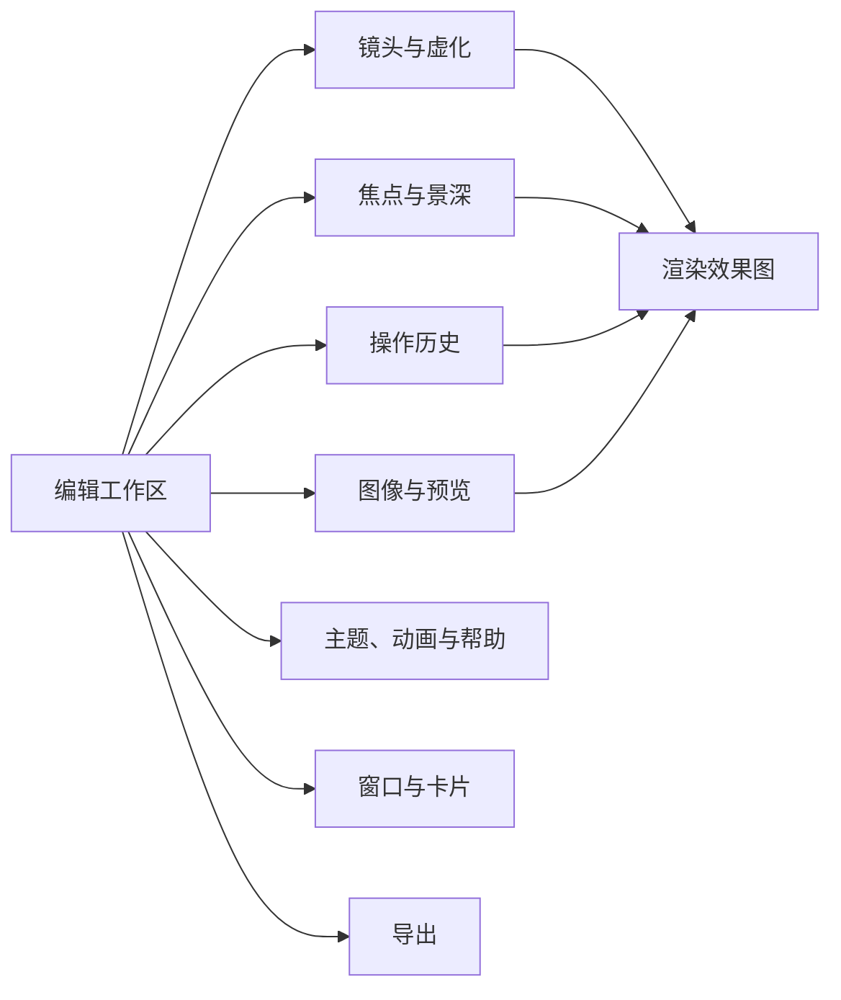
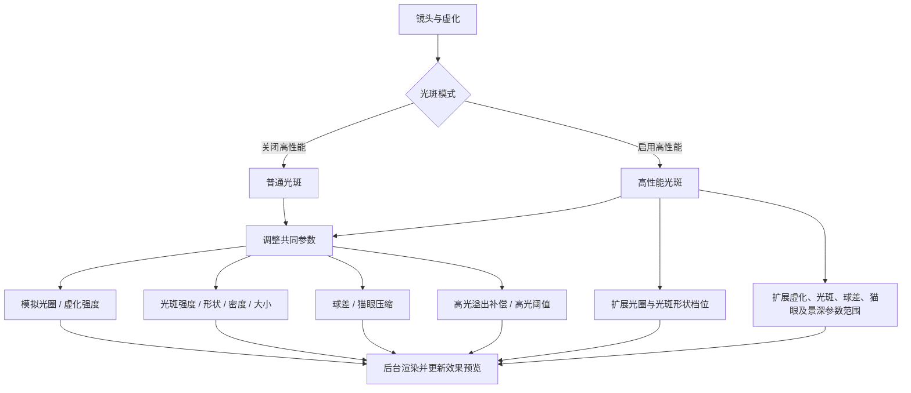
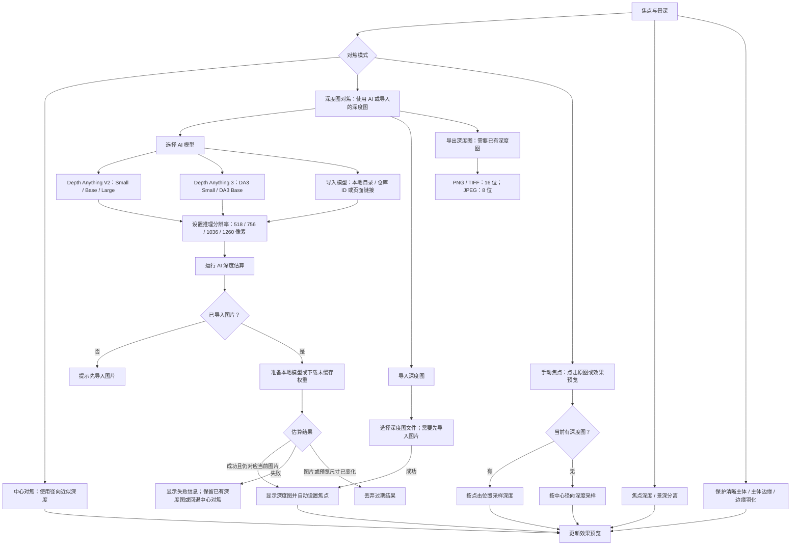
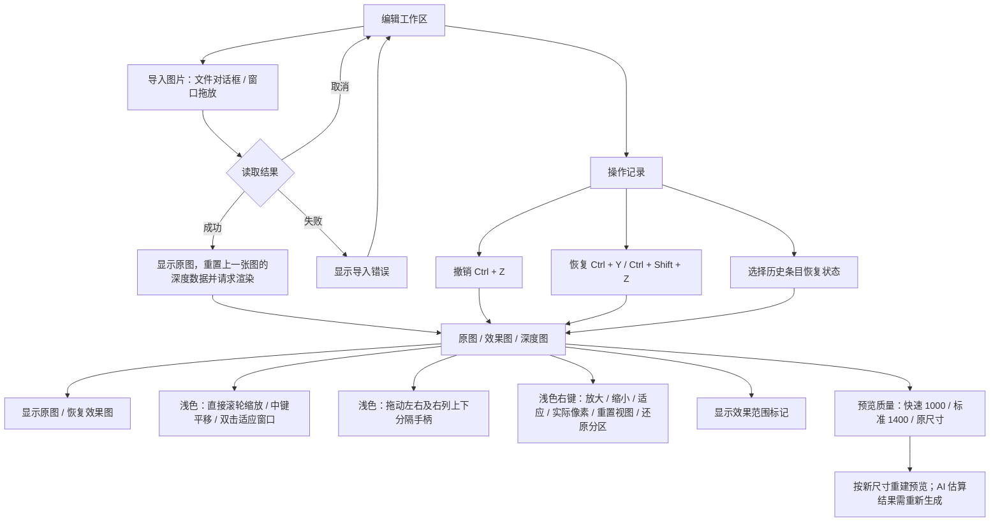
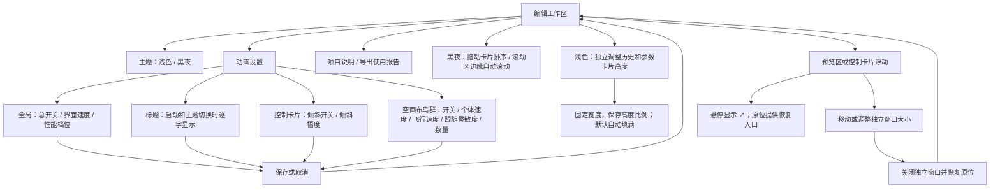
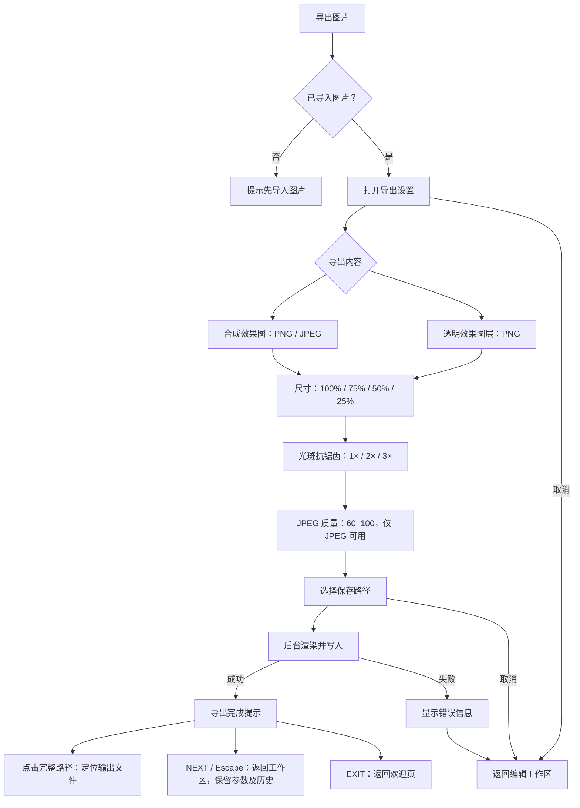

# 现有功能与详细分支参考

本文记录主工作区统一流程图整理前的现有功能、参数范围和技术分支，用于核对功能保留。新版入口和展示方式以[主工作区流程图](INTERACTION-FLOW.md)及后续确认结果为准。

浅色工作区已将本页列出的处理功能绑定至同一套参数、历史和渲染状态。镜头的 11 项控制常驻，焦点附加功能通过其分组标题展开；原图对比、撤销、恢复、直方图和返回欢迎页由中栏「设置」菜单进入，黑夜模式保留既有入口。参数范围仍以用户说明主表为准。

## 编辑工作区功能总览

以下流程依据当前源码整理，用于标识重构需要承接的能力。**功能分组用于说明操作关系，不代表设计稿已经确定了入口位置、弹窗外观或新的页面跳转。**

## 镜头与虚化

参数范围与输入步长统一见[用户说明主表](../../README.md#参数范围与精确输入)，本文件保留功能分支及触发关系。切回普通模式时，超出普通范围的值暂存，再次启用高性能模式时恢复。

## 焦点、景深与 AI 模型

内置模型及仓库由 [`MODEL_SPECS`](../../app/depth_worker.py) 定义：

| 模型 | 仓库 | 标注大小 |
| --- | --- | --- |
| Depth Anything V2 Small | `depth-anything/Depth-Anything-V2-Small-hf` | 约 95 MB |
| Depth Anything V2 Base | `depth-anything/Depth-Anything-V2-Base-hf` | 约 390 MB |
| Depth Anything V2 Large | `depth-anything/Depth-Anything-V2-Large-hf` | 约 1.3 GB |
| DA3 Small | `depth-anything/DA3-SMALL` | 约 131 MB |
| DA3 Base | `depth-anything/DA3-BASE` | 约 480 MB |

默认模型为 Depth Anything V2 Small。内置 DA3 模型使用独立运行依赖。导入本地模型时，现有界面检查 `config.json` 与 `model.safetensors` 或 `pytorch_model.bin`；仓库形式在首次估算时检查缓存并按需下载。分辨率调整仅影响下一次 AI 估算。实际依赖和模型兼容性由当前运行环境决定。

焦点、景深及主体边缘的范围见[参数主表](../../README.md#参数范围与精确输入)，作用说明见[操作说明](../../README.md#操作说明)。本节继续维护深度来源、模型准备、失败回退及过期结果等处理分支。

## 图片、预览与历史

预览质量调整时，已导入的完整深度图可按新尺寸重新缩放；通过 AI 估算得到的预览深度需要重新运行估算。效果范围标记只影响预览。

图像直方图在浅色参数卡片顶部直接显示，也可由「设置 → 图像直方图」打开独立窗口；黑夜模式保留可折叠卡片。各处共用统计与通道状态，随处理结果及原图对比刷新；效果范围标记不参与计数。R / G / B 三个方形按钮互斥选择及再次点击取消，全未选时显示亮度。灰底白条及无额外图表文字的规则见[操作说明](../../README.md#操作说明)。

浅色预览的三张画布分别保存缩放和平移；分隔手柄只修改视口分配，浮动时调整原位占位，不重新创建画布。首次载入按等比覆盖显示；双击或「适应窗口」按当前视口容纳全图；「重置视图」恢复当前视口的覆盖基准与居中状态。「实际像素」将当前预览像素按一个逻辑像素显示，预览可能已按质量选项降采样，不等同于原始文件的完整分辨率。右键「还原预览分区」恢复两轴默认比例，不清除图片视图状态。

黑夜模式保留 Ctrl + 滚轮缩放、Ctrl + 中键平移和双击复位的既有操作。浅色分隔手柄的方向键、Home、双击及设置保存规则统一见[当前窗口与预览规则](INTERACTION-FLOW.md#当前窗口与预览规则)；两轴默认比例由源矩形计算，持久化键由设计参数清单维护。

## 主题、动画与面板

全局动画和鸟群飞行均有 0.5×、1×、1.5×、2× 四档速度。流畅、均衡和省电档位的目标更新间隔分别为 8、16、33 ms，实际帧率受设备及显示器限制。卡片倾斜幅度、鸟群跟随灵敏度各有三档，粒子数量可设为 12、24 或 40。确认后应用并保存设置，取消保留原值。关闭全局动画会暂停鸟群。

浅色工作区的七处预览或控制部件可独立打开和归位。拖动、键盘调节、分区复位及滚轮缓动分别见[窗口与预览规则](INTERACTION-FLOW.md#当前窗口与预览规则)和[动效与操作反馈](INTERACTION-FLOW.md#动效与操作反馈)。

## 导出设置与结果

普通模式的独立光斑层按所选倍数超采样。高性能光斑使用波前核采样。图片与透明图层使用专用导出完成页，深度图和使用报告使用通用完成消息。

