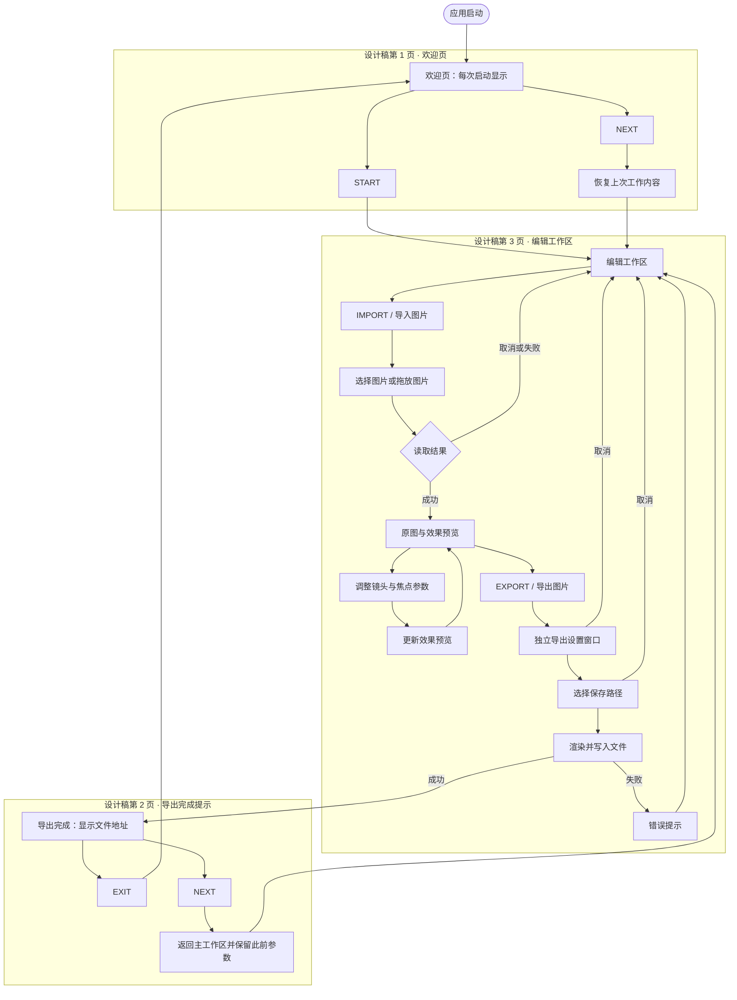
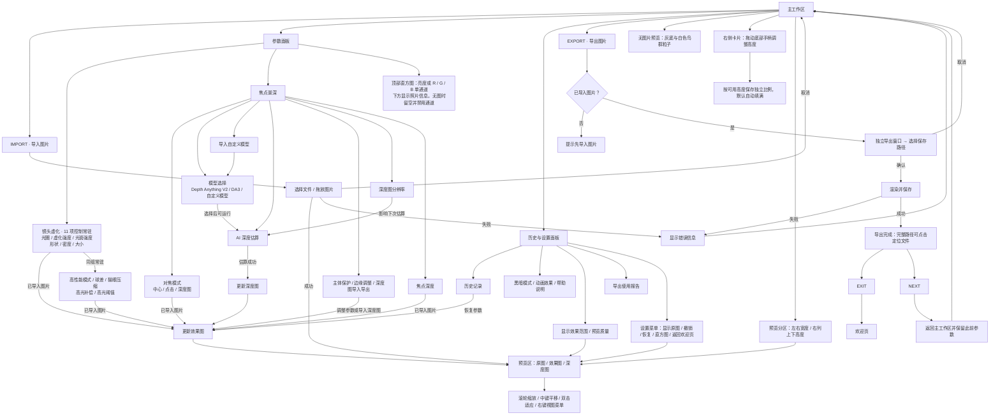

# 浅色界面交互流程图

可视化编辑版本见[工作区流程图.drawio](工作区流程图.drawio)，操作方法见[编辑说明](流程图编辑说明.md)。

本文记录页面跳转、操作结果和异常分支。[待填写事项](#待填写事项)保留 17 项原始回答。遇到冲突时，以原回答为准。其后明确修订的卡片高度、预览分区和图片信息分别见[当前窗口与预览规则](#当前窗口与预览规则)与下方工作区流程。

## 页面与主要流程

欢迎页 `START` 进入空白工作区。`NEXT` 恢复上次有效图片会话，无可恢复记录时进入空白工作区并提示。同进程恢复历史，跨启动以恢复的图片、深度、参数和预览选项建立新基线。原图缺失时保留参数，文件有变更时丢弃旧深度，未完成的 AI 任务不写入会话。

图片导出成功后显示完整路径，可选择、复制，点击可在文件管理器中定位。结果页的 `EXIT` 返回欢迎页，`NEXT` 或 Esc 返回当前工作区并保留图片、参数、深度及历史。保存失败通过统一错误窗口提示，可关闭提示返回工作区。

## 主工作区统一流程

以下按设计稿及已填写的交互要求整理。镜头参数常驻于同一分组，焦点附加功能通过其黑色标题展开，参数溢出时滚动访问。预览区与控制卡片悬停显示「↗」入口，独立打开后支持移动、缩放和关闭归位。

- **预览区**保留原图、效果图和深度图。无图片时使用灰底和白色鸟群粒子。图片缩放保持宽高比，窗口变化时可由视口裁切遮挡。浮动窗口的概念说明见[图文解释](浮动窗口说明.md)。
- **历史与设置面板**按设计稿合并呈现历史记录、主题、动画、帮助、效果范围、预览质量及使用报告。历史状态的撤销、恢复与跳转能力继续保留。
- **右侧参数面板**按「镜头虚化」与「焦点景深」分组。镜头的 11 项控制常驻，点击其标题不隐藏参数；焦点深度、景深分离、深度图导入导出、AI 估算及主体边缘控制通过「焦点景深」标题展开，▸ / ▾ 表示收起及展开，初始为收起状态。参数列表溢出时滚动，两个分组复用同一标签、输入和数值列。
- **顶部统计与图片信息**随预览更新。点击 R、G 或 B 只显示该通道，再次点击回到亮度。浅色面板、黑夜卡片和独立窗口共享选择。「显示原图」切换统计来源，效果范围标记不参与计数。清空图片时，直方图区与信息条留空，通道按钮禁用。再次导入图片后恢复当前通道。
- **模型选择**保留现有 Depth Anything V2 Small / Base / Large、DA3 Small / Base 及自定义模型。分辨率、失败提示和缓存行为见[现有功能与详细分支参考](FUNCTION-REFERENCE.md)。
- 独立示意中的第二个「模型选择」对应深度图分辨率，「光斑密度」滑块对应焦点深度；额外的 EXPORT 示意对应主导出按钮打开的独立导出窗口。
- 黑、蓝、红三点当前作为装饰；黑夜模式保留此前版本的布局。

## 当前窗口与预览规则

本节为后续已确认并接入的运行修订，替代原回答第 12 项中控制区域高度始终固定的部分。原回答行不改写；控件字号、卡片宽度与表单列网格继续保持固定逻辑尺寸。

- **右侧卡片**默认填满上方工作区，底部停在 IMPORT / EXPORT 按钮实体顶边前 22 逻辑 px。历史和参数卡片可分别调短，并按各自可用高度保存比例；自动高度对应比例 1。增高历史卡片时扩展列表、下移下方设置组，参数卡片则扩展滚动视口。卡片浮动时隐藏页面高度手柄，拖动独立窗口标题区移动，拖动右下手柄缩放。
- **预览分区**提供原图与右列之间、效果与深度之间两条分隔手柄。调整比例保持源间隔、标签及图像宽高比；浮动预览的原位占位继续参与布局。默认比例来自源测量，两个比例分别保存；还原分区不重建图片，也不清除各自的缩放和平移。
- **完整参数浮动窗口**保留表单、内边距和滚动条所需宽度，纵向内容通过滚动访问；最小宽度及其来源见[页面约束](LIGHT-RESET.md#缩放与排版约束)。焦点的附加控制仍由带状态标记的标题展开。

| 操作对象 | 主要操作 | 调整与复位 |
| --- | --- | --- |
| 卡片高度手柄 | 拖动底边；双击恢复自动填满 | Up / Down 每次 8 逻辑 px，Shift 为 32；Home 最短，End 自动填满 |
| 预览分隔手柄 | 拖动；双击恢复该轴默认比例 | 对应方向键每次 8 逻辑 px，Shift 为 24；Home 复位，Esc 取消当前拖动 |
| 预览图片 | 直接滚轮缩放，无需 Ctrl；中键拖动平移；双击左键适应窗口 | 右键菜单提供放大、缩小、适应窗口、实际像素、重置视图及还原预览分区 |

高度和分区比例在调整完成后写入设置，下次进入沿用。首次载入图片仍按等比覆盖建立基准；「适应窗口」按当前视口容纳全图，「实际像素」显示当前预览像素比例，「重置视图」恢复该视口的初始覆盖状态。完整说明及预览质量限制见[图片与预览参考](FUNCTION-REFERENCE.md#图片预览与历史)。

## 动效与操作反馈

- 欢迎页逐字显示「伯爵大光圈」，首句完成后停留 3 秒，再逐字显示「今天我们要模拟什么」。动画关闭时直接显示第二句。光标频率、字形与图层见[欢迎页规范](LIGHT-RESET.md#欢迎页)。
- 浅色参数卡片、浮动卡片及黑夜控制区的滚轮采用三次缓出。连续滚动累积目标位置，触控板按像素跟随。拖动滚动条、程序定位或隐藏卡片会中止缓动。关闭动画后立即滚动。
- 「焦点景深」展开时使用三次缓出。展开后的定位会取消此前的滚动目标，使当前分组留在视口中。

## 待填写事项

| 编号 | 位置 | 待填写 |
| --- | --- | --- |
| 01 | 应用启动 | 启动后显示的页面：欢迎页 |
| 02 | 欢迎页 `START` | 执行操作及去向：点击后跳转到主工作区 |
| 03 | 欢迎页 `NEXT` | 执行操作及去向：继续上次的工作内容 |
| 04 | 导出完成 `EXIT` | 执行操作及去向：切回欢迎页 |
| 05 | 导出完成 `NEXT` | 执行操作及去向：切回主工作区同时保留之前的参数 |
| 06 | 欢迎页 | 每次启动是否显示，以及是否可以再次进入：每次启动都显示 |
| 07 | 无图片时 | 灰色占位、透明背景及鸟群的显示规则：灰底，显示白色粒子作为鸟群 |
| 08 | 编辑工作区 | 设计稿未展示的功能入口及其收纳位置：未展示功能参考设计稿已经给了的内容 |
| 09 | 窗口控制 | 面板右上方黑、蓝、红三点的作用：暂时无作用 |
| 10 | 工作区 | 主题切换后黑夜模式的布局与返回方式：布局和以前版本不变 |
| 11 | 导出完成 | 文件地址、序号的展示与交互方式：完整的文件地址，点击后直接跳转到文件管理器，序号随机0-9 |
| 12 | 窗口缩放 | 预览区域、历史区域和参数区域的伸缩规则：缩放窗口时预览区域不改变比例直接裁切遮挡图片，ui随之变化，其他区域始终不随窗口缩放 |
| 13 | 独立窗口 | 浮动后的标题、恢复入口与外观：这个我看不懂是什么意思你图文解释一下 |
| 14 | 首页背景 | PDF 红色插图与 AI 兼容预览差异采用的版本：优先采用pdf,ai你要读完整你看看是不是兼容性问题没有显示，同时有些素材不在ai画布上 |
| 15 | 焦点景深 | 独立示意中第二个「模型选择」和「光斑密度」滑块的作用、显隐条件：那个对应的是深度图分辨率和焦点深度，这是我给你的大概示意，不需要太在意 |
| 16 | 图片信息 | 信息区的来源、无数据时的显示及是否可交互：无照片时不显示内容和交互 |
| 17 | 底部导出 | 独立的 EXPORT 示意与主导出按钮的关系：点击主导出按钮后弹出独立的导出窗口 |

## 原始回答的补充依据

| 原始项目 | 当前依据 |
| --- | --- |
| 04、05 导出导航 | `EXIT` 保留原稿文案并返回欢迎页。按钮外观及白色字形见[导出完成提示](LIGHT-RESET.md#导出完成提示) |
| 12 窗口缩放 | 右侧卡片宽度固定，高度可分别调整。左侧分区与图片视图独立调整。详见[当前窗口与预览规则](#当前窗口与预览规则) |
| 13 独立窗口 | 七处部件的打开、移动、缩放与归位见[浮动窗口说明](浮动窗口说明.md)。切换主题或返回欢迎页前，浮动部件归位 |
| 14 首页背景 | 首页以 PDF 成稿为准，Illustrator 兼容蒙版和画板外素材见[设计文件检查记录](设计文件检查记录.md) |
| 16 图片信息 | 未导入图片时直方图与元数据留空。通道按钮保留位置并禁用，具体布局见[编辑工作区](LIGHT-RESET.md#编辑工作区) |
