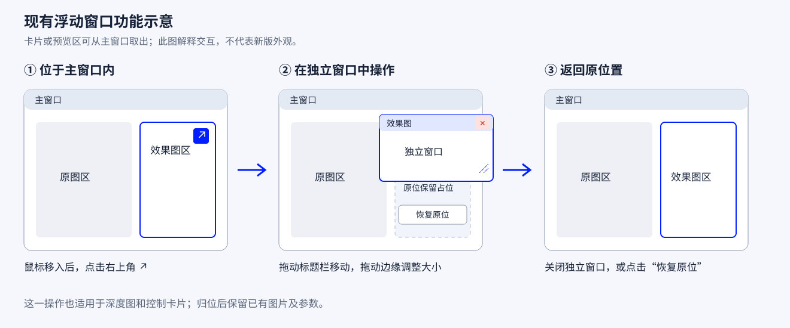

# 浮动窗口说明

浅色工作区有七处部件可独立打开。预览包括原图、效果图和深度图。控制部件包括历史与设置、完整参数面板、「镜头虚化」和「焦点景深」。

1. **打开。** 将指针移入部件，点击右上角的「↗」。该部件进入独立窗口，原位置显示「恢复原位」。
2. **移动与缩放。** 拖动窗口标题区可移动，拖动右下角手柄可缩放。浮动预览保留当前图像视图，完整参数窗口为表单及滚动条预留宽度。
3. **归位。** 关闭独立窗口或点击「恢复原位」，部件返回原位置，图像与参数状态随之保留。切换主题或返回欢迎页时，软件自动归位。

窗口的标题、圆角、描边和尺寸见[二级窗口运行度量](VISUAL-SCALE.md#二级窗口运行度量)。
