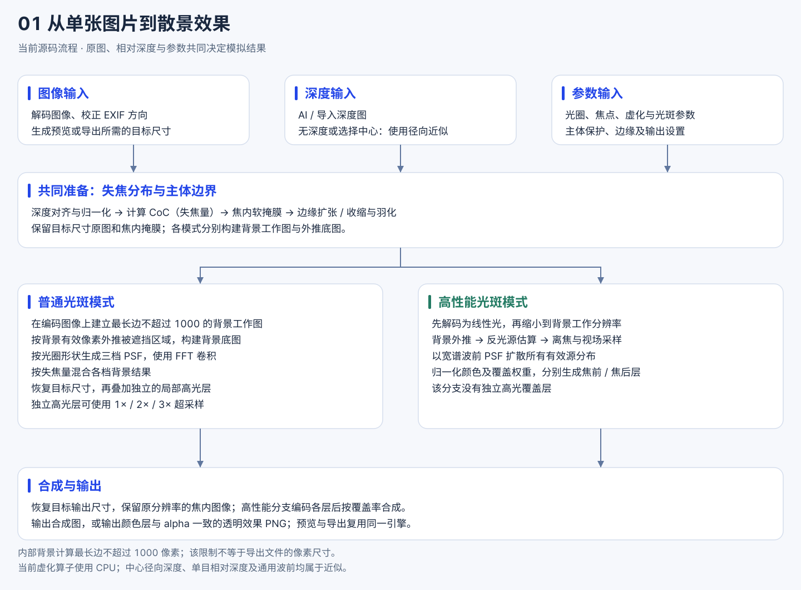
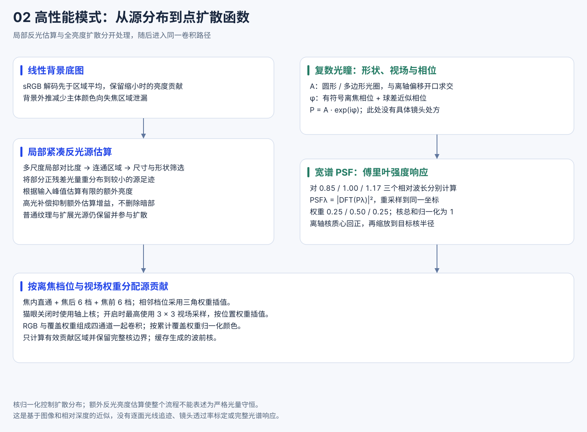
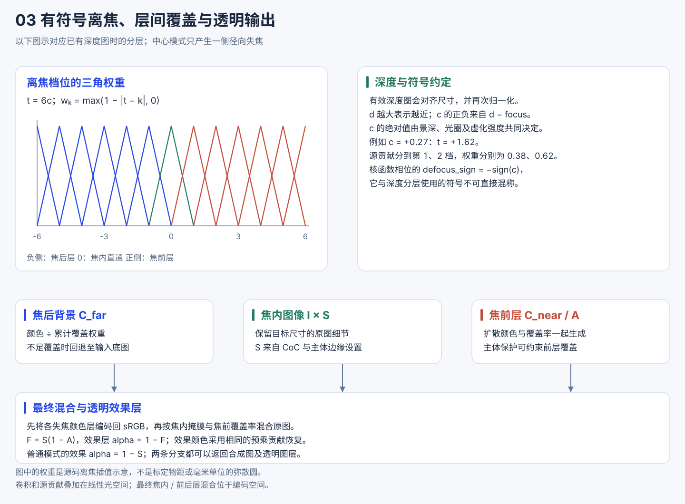
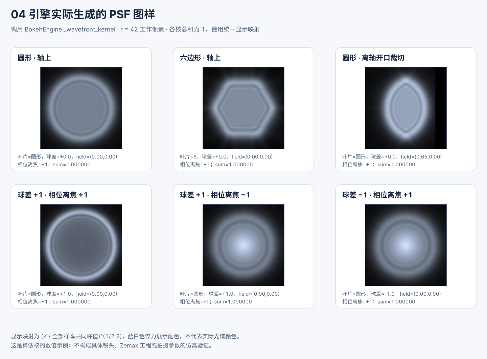

# 光斑模拟流程图解

本目录介绍当前源码的景深虚化与光斑模拟流程，包含可离线浏览的图解、算法步骤、参数作用及可重复执行的绘图脚本。内容独立于软件界面与运行资源。

直接打开 [index.html](index.html) 浏览四张图；Markdown 阅读顺序如下。图中 PSF 指点扩散函数，CoC 在本项目中指归一化失焦权重。

| 图 | 内容 | 文件 |
| --- | --- | --- |
| 01 | 输入、共同准备、普通 / 高性能分支及输出 | [PNG](figures/01-pipeline.png) / [SVG](figures/01-pipeline.svg) |
| 02 | 线性光、背景外推、反光源估算、波前与视场插值 | [PNG](figures/02-wavefront.png) / [SVG](figures/02-wavefront.svg) |
| 03 | 有符号离焦、三角权重、层间覆盖与透明输出 | [PNG](figures/03-depth-composition.png) / [SVG](figures/03-depth-composition.svg) |
| 04 | 引擎直接生成的六组 PSF 样本 | [PNG](figures/04-psf-samples.png) / [SVG](figures/04-psf-samples.svg) |

## 1. 输入与处理总览



图像读取后校正 EXIF 方向并转成 8 位 RGB。处理链按 sRGB 编码解释这些数值，当前没有完整 ICC 色彩管理。预览和导出先确定各自的输入尺寸，再将图像、深度和 `EngineSettings` 交给同一个 `BokehEngine.process()`。

深度有三种来源：

- **AI 估算**支持 Depth Anything V2 Small / Base / Large、DA3 Small / Base 和导入的模型。V2 将预处理结果送至模型所在的 CPU 或 CUDA 设备。模型输出统一为近处数值较大，DA3 使用分位数归一化，V2 使用最小值与最大值归一化。
- **导入灰度深度图**：按 min-max 归一化，不自动识别远近方向；输入应遵循亮处较近的约定。
- **中心径向近似**：没有深度图或选择中心对焦时，使用到 `(0.5W, 0.46H)` 的归一化径向距离。此距离代表图像中的清晰范围，不是测得的物体距离。

导出使用完整原图的所选比例，优先采用导入的完整深度；否则将当前 AI 预览深度缩放到导出尺寸，不自动重新估算 AI。预览输入尺寸与背景内部工作尺寸是两层不同概念。

## 2. 共同准备：失焦与主体掩膜

1. 对齐深度与目标图像尺寸；有深度图时再做 min-max 归一化。
2. 计算 0–1 的 CoC。深度图对焦以 `abs(depth − focus)` 为基础；中心模式使清晰半径内的失焦为零，向外单向增加。光圈、景深分离和虚化强度共同调整权重。
3. 由 CoC 生成焦内软掩膜 `S`，执行平滑过渡，并按主体边缘及羽化设置调整。关闭主体保护仍会保留焦内层。
4. 扩张保护区并腐蚀背景有效权重，减少主体边缘的混合像素污染背景。
5. 将背景工作图限制在最长边不超过 1000 像素；完整目标尺寸的原图及焦内掩膜保留至最终合成。
6. 在四分之一背景工作尺寸上做带权背景外推，填充被主体遮挡的位置，形成 `clean` 底图。这里的高斯 / 盒式滤波用于估计低频背景；后续散景扩散由各模式的 PSF 完成。

高性能模式在区域平均缩小前解码 sRGB；普通模式直接处理编码图像。高性能模式在 CoC 全为零时直接返回原图，透明效果层为空。

## 3. 高性能模式的源分布与波前 PSF



### 3.1 线性光与源估算

归一化 sRGB 通道值为 `C`，线性值为：

```text
L = C / 12.92                         C ≤ 0.04045
L = ((C + 0.055) / 1.055)^2.4         其他
```

`reconstruct_bokeh_sources()` 使用多尺度局部正对比度寻找紧凑反光，并按连通区域面积、尺寸及形状筛选。光斑密度调整局部识别阈值；未被选中的纹理、暗部和扩展光源保留原分布，继续参与 PSF 扩散。

对选中的候选，算法将部分正 RGB 残差重分布到更小的源足迹。被移动的残差保持其原有光量，同时另施加与峰值及光斑强度相关的有限亮度增益；高光补偿抑制额外增益。这是对普通图像中受压缩反光的启发式估计，不能恢复真实 HDR，也不构成严格的全局光量守恒模型。

平坦区域中许多点扩散贡献叠加后可维持近似均匀；孤立反光更容易呈现可辨认的光圈轮廓。该分支中的局部检测影响源估计，不决定哪些像素允许产生失焦贡献。

### 3.2 复数光瞳与宽谱核

`_wavefront_kernel()` 在 256 × 256 采样面建立光瞳振幅 `A`。圆形或带叶片的光圈与离轴偏移开口求交，用于近似视场边缘的口径裁切。相位采用以下通用参数：

```text
ρ² = x² + y²
waves = clip(radius / 2.5, 2.5, 13)
aberration = clip(spherical, −2, 2) · ρ² · (1 − 0.5ρ²)
φ = 2π · waves · (defocus_sign · ρ² + 0.45 · aberration)
Pλ = A · exp(iφ / λ)
Kλ = resample(|DFT(Pλ)|²)
```

相对波长为 0.85、1.00、1.17，权重为 0.25、0.50、0.25。各波段在一致像面坐标中归一化并加权；离轴结果按质心回正，缩放到目标核尺寸后再次归一化。

三个相对波长的结果形成一组共用 RGB 核。该方法近似宽谱强度扩散，没有读取具体镜片曲率、厚度、玻璃材料或光圈位置，也未计算各颜色通道独立的光谱响应。核归一化控制扩散分布，不标定镜头透过率及真实渐晕光量。

### 3.3 半径、离焦档位与视场插值

有深度图时，有符号离焦为 `c = copysign(CoC, depth − focus)`；负侧进入焦后层，正侧进入焦前层。中心径向模式取 `c = −CoC`。核相位的 `defocus_sign` 与分层符号相反。

基础核半径按以下图像算法参数构造：

```text
R1000 = 26 · sqrt(bokeh_size) · (0.82 + 0.36 · bokeh_strength)
        · max(1, blur_strength)
```

大于 80 后连续软限幅并渐近 128，再按背景工作图最长边与 1000 的比例换算。光斑大小按面积比例作用于半径；这些数值不表示由真实焦距、物距和传感器尺寸标定的毫米弥散圆。

离焦采样包含焦内直通和焦前、焦后各六档。令 `t = 6c`，相邻档位按 `wₖ = max(1 − |t − k|, 0)` 分配贡献。猫眼关闭时使用轴上核，开启时最高使用 3 × 3 视场核和位置权重插值。

每个有效深度 / 视场区域将加权 RGB 与覆盖权重组成四通道一起卷积，再将累计颜色除以累计覆盖权重。焦前层额外受到背景权重约束；焦后缓冲包含焦内直通贡献。有效区域裁剪保留完整核边界，缓存减少重复生成核的开销。

## 4. 层间合成与透明效果图层



背景颜色、焦前预乘颜色和覆盖率恢复到目标尺寸，缩放焦前层时使用预乘颜色以减少暗边。输出按通道、每 256 行一段处理，以限制中间工作内存。

以下是高性能分支最终合成的等价说明。`E()` 表示将线性值裁切至 0–1 后编码为 0–255 的 sRGB 数值，`S` 为焦内权重，`A₀` 为卷积得到的焦前覆盖率。公式中的 alpha 为归一化值，写入 PNG 时再量化：

```text
A = A₀ · (1 − S)                     主体保护开启
A = A₀                               主体保护关闭
F = S · (1 − A)
P = E(C_far) · (1 − A) · (1 − S) + E(C_near) · A
final = round(P + original · F)
effect_alpha = 1 − F
effect_color = P / max(effect_alpha, ε)
```

无焦前层时取 `A = 0`。图像扩散与源贡献叠加在线性光空间完成，最终近远层及焦内原图混合在 sRGB 编码空间进行。透明效果 PNG 使用同一组 `effect_color` 与 `effect_alpha`，按标准 alpha 叠回同尺寸原图，可在 8 位量化误差范围内重建合成结果。输出为 8 位 RGB 或 RGBA，未提供 HDR 文件输出。

## 5. 普通模式的区别

普通模式使用圆形或多边形光圈核以及径向球差权重，在编码 RGB 背景上计算 0.40、0.70、1.00 三档半径的 FFT 卷积，并按 CoC 混合。恢复目标尺寸后，再检测局部突出且较亮的候选，绘制独立高光层，最后与焦内原图混合。

独立高光层支持形状、大小、密度、球差、猫眼压缩和高光补偿；1× / 2× / 3× 超采样只作用于此普通覆盖层。普通模式的透明效果 alpha 为 `1 − S`。当前高性能入口会提前返回，不调用这一独立高光层，即使该旧函数中仍保留同名条件判断。

## 6. 参数作用位置

本表说明参数在高性能分支中的作用阶段，取值范围由根目录[用户说明](../../README.md#参数范围与精确输入)统一维护。

| 参数 | 主要作用阶段 |
| --- | --- |
| 模拟光圈 | CoC 增益；不是具体镜头曝光或几何光学标定 |
| 焦点深度 | 有深度时调整焦点平面；中心近似时调整清晰半径 |
| 景深分离 | 调整深度差异对应的离焦权重 |
| 虚化强度 | 调整 CoC；超过基础范围后进一步扩大核半径 |
| 光斑大小 | 以面积比例调整扩散半径 |
| 光斑强度 | 调整核半径、局部反光残差重分布及有限增益 |
| 光斑密度 | 调整紧凑反光的局部对比度识别阈值 |
| 光斑形状 | 调整光瞳振幅轮廓 |
| 球差 | 调整波前相位，与有符号离焦共同改变核分布 |
| 猫眼压缩 | 调整视场相关的开口偏移和光瞳裁切 |
| 高光补偿及阈值 | 约束源估算中的额外亮度增益 |
| 主体保护、边缘与羽化 | 调整焦内掩膜、背景有效区域及前层覆盖 |
| 深度图分辨率 | 影响下次 AI 推理，不在调节时自动重新估算 |
| 光斑抗锯齿 | 普通覆盖层超采样；不改变高性能波前核采样 |

## 7. 实际 PSF 样本



六个样本直接调用当前 `_wavefront_kernel()`，核半径均为 42 个背景工作像素，分别展示圆形、六边形、离轴开口裁切和不同球差 / 相位离焦组合。所有核的数值总和为 1，显示采用共同峰值及同一幂函数；蓝白色仅为展示配色。样本用于说明算法行为，不作为特定镜头或 Zemax 工程的验证结果。

## 8. 文件及重新生成

```text
simulation-guide/
├── README.md                  算法说明与图解
├── index.html                 离线图册入口
├── generate_diagrams.py       绘图与 PSF 样本生成脚本
├── source-snapshot.json       依据的源码指纹及样本参数
└── figures/                   4 张 SVG 和 4 张 PNG
```

在已安装项目依赖的环境中，从项目根目录执行：

```powershell
.\.venv\Scripts\python.exe docs\simulation-guide\generate_diagrams.py
```

脚本只导入图像引擎、Qt 绘图及本地字体；不启动主窗口、不下载模型、不改写算法。图片和图册可直接阅读，只有重新生成时才需要项目依赖。源码改变后，先复核文字步骤，再运行脚本更新图像和源码指纹。

## 9. 代码对应与模型边界

| 内容 | 代码入口 |
| --- | --- |
| 总流程、CoC 与主体掩膜 | [engine.py](../../app/engine.py)：`process`、`_make_coc` |
| 紧凑反光源估算 | [bokeh_sources.py](../../app/bokeh_sources.py)：`reconstruct_bokeh_sources` |
| 光瞳、波前与 PSF | [engine.py](../../app/engine.py)：`_wavefront_kernel` |
| 深度 / 视场插值 | [engine.py](../../app/engine.py)：`_render_wavefront` |
| 合成与 alpha | [engine.py](../../app/engine.py)：`_composite_wavefront` |
| 普通 PSF 与高光层 | [engine.py](../../app/engine.py)：`_disc_blur_levels`、`_bokeh_overlay` |
| 深度模型和方向 | [depth_worker.py](../../app/depth_worker.py)：`MODEL_SPECS`、`DepthWorker` |
| 输入、预览调度和导出 | [main.py](../../app/main.py)：图像读取、`RenderWorker`、导出处理 |

本模型依赖单张图像与相对深度。遮挡后的真实背景由低频估算补全；反光源亮度是有限估计。未实现镜片逐面追迹、真实光谱色差、鬼影、多次反射或传感器模型；当前算子采用 CPU，高性能模式名称不表示启用 CUDA。
