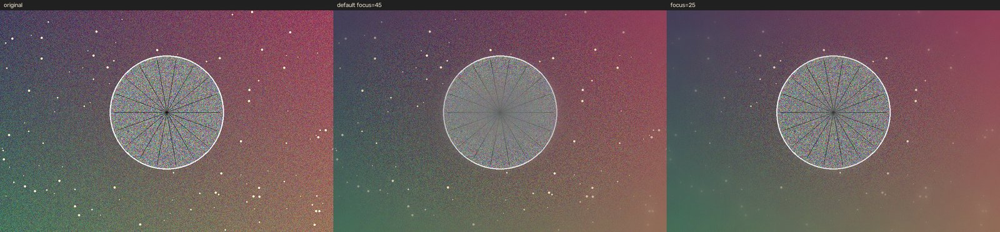

# 伯爵大光圈 · 代码检查报告

> **目录调整（2026-10-19）**：源码现在 `app/`，本文中的代码链接已同步到 `../app/`；图片位于 `docs/images/`。

> **修复状态（2026-10-18）**：本报告中的 P0/P1 及主要 P2 已修复，验证数据与改动说明见 [修复记录.md](修复记录.md)。以下内容保留为问题定位与复现记录。

- **检查对象**：`C:\Users\21955\Downloads\伯爵大光圈`（8 个源文件，检查过程中未修改任何一行源代码）
- **检查时间**：2026-10-18
- **运行环境**：Windows，Python 3.11.9，PySide6 6.12.0，OpenCV 5.0.0.93，NumPy 2.4.6，CPU（无 CUDA）
- **检查方法**：逐行代码审查 + 在临时虚拟环境中安装依赖并实际启动 GUI（offscreen 模式）+ 引擎量化测试（清晰度、耗时、峰值内存）+ 文件路径与线程生命周期复现实验
- **未覆盖**：torch / transformers 体积过大未安装，AI 深度估算只做了代码审查与“缺少依赖”时的降级测试；未在真实显示器上评估观感

---

## 总体结论

**能运行，但目前还不能算“可交付”。**

程序在无 AI 模型时可以启动、打开图片、调参、预览、导出；代码结构清楚，缺少 AI 依赖时也能给出可读的提示。不过存在 3 个阻断级问题：**中文路径下读/写图片失败、默认对焦把主体虚化、全分辨率导出丢失 AI 深度**；此外还有 2 个可复现的崩溃/异常和 1 个“界面上有、实际没实现”的功能。

对一个中文命名的软件来说，P0-1 尤其致命：软件自己的目录名就是中文，默认导出文件名也是中文，而 OpenCV 在 Windows 上不认非 ASCII 路径。结果是**默认情况下“打开 → 导出”这条主链路走不通**。

另外，README 写的“实时调整”和“4 GB 以上内存”与实测不符（1400px 预览每次滑块约 375 ms；24MP 导出峰值内存约 4.1 GB）。

---

## 一、阻断级问题（P0）

### P0-1　中文路径下无法读图/写图（默认导出名就是中文）

**位置**：[main.py:218](../app/main.py#L218)（`cv2.imread`）、[main.py:338](../app/main.py#L338)（`cv2.imwrite`）、[main.py:317](../app/main.py#L317)（默认文件名 `伯爵大光圈效果.png`）

Windows 版 OpenCV 的 `imread` / `imwrite` 走 ANSI 路径，不认 UTF-8 中文。实测矩阵（OpenCV 5.0.0.93）：

| 目录 | 文件名 | `imwrite` 返回 | 目标文件是否存在 | `imread` |
|---|---|---|---|---|
| ASCII | ASCII | `True` | 是 | 正常 |
| **中文** | ASCII | **`False`** | 否 | 失败 |
| ASCII | **中文** | **`True`（假成功）** | **否**（写到了乱码文件名） | 失败 |
| **中文** | **中文** | **`False`** | 否 | 失败 |

实测后果：

1. 软件放在 `...\伯爵大光圈\` 里，导出到该目录 → `cv2.imwrite` 返回 `False` → 弹“写入文件失败”，**导不出来**。
2. 即使软件放在纯英文目录，默认文件名是中文，`imwrite` 会返回 `True` 但把文件写成乱码名字，界面却提示“导出完成”，**用户找不到文件**。
3. 用户照片放在 `图片\旅行\...`、文件名含中文时，`imread` 返回 `None`，界面提示“无法读取该图片格式”，**打不开**。

我在 GUI 里实测导出：完整分辨率 2400×3840，处理耗时 2.8 s，最后 `cv2.imwrite` 失败，文件不存在；改用 ASCII 临时目录后导出成功（1.46 MB PNG）。同一份代码，只差路径编码。

**修复**（读、写都改，约 10 行）：

```python
# 读
data = np.fromfile(path, dtype=np.uint8)
image = cv2.imdecode(data, cv2.IMREAD_COLOR)

# 写
ok, buf = cv2.imencode(ext, bgr, params)
if not ok:
    raise IOError("编码失败")
buf.tofile(path)
```

`np.fromfile` / `ndarray.tofile` 走 Python 的文件系统编码，中文路径正常；`imdecode` / `imencode` 只处理内存数据。已在同一台机器上验证可行。

---

### P0-2　默认“中心对焦”把主体虚化，清晰区是一条环带

**位置**：[engine.py:36-42](../app/engine.py#L36-L42)（`_center_depth`）、[engine.py:44-50](../app/engine.py#L44-L50)（`_make_coc`）、[main.py:133-135](../app/main.py#L133-L135)（焦点默认 45）

`_center_depth()` 返回“到画面中心的距离”（中心 0.05，四角 0.95），`_make_coc()` 用 `abs(depth - focus)` 计算虚化量。默认 `focus=0.45` 时，**中心（主体）离焦平面 0.40，反而被模糊；清晰区是半径约 0.3 的一圈环带**。

实测（800×600 合成场景，Laplacian 方差保留率，相对原图）：

| 焦点滑块 | 中心主体保留 | 环带保留 | 结果 |
|---|---|---|---|
| 0 | 24.7% | 0.7% | 中心较清晰但背景全糊 |
| 0.05 | 39.7% | 1.3% | 同上 |
| 0.25 | 80.7% | 21.7% | 中心最清晰 |
| **0.45（默认）** | **23.3%** | **87.6%** | **主体被虚化，环带清晰** |
| 0.70 | 0.8% | 18.0% | 中心全糊 |
| 0.95 | 0.5% | 0.7% | 全糊 |



左：原图；中：修复前默认 focus=45（中心主体明显发灰、细节丢失）；右：focus=25（主体恢复清晰）。

补充：

- `_center_depth(self, h, w, focus)` 的 `focus` 参数**从未被使用**，说明这个函数本来还打算做“按焦点塑形”，但没写完。
- 即使把滑块拉到 25，中心也只有 80.7%，因为径向深度在整个主体圆盘内持续上升，圆盘边缘仍被判定为失焦。
- AI 模式下 `depth` 是“越近值越大”的视差图，默认 `focus=0.45` 同样不一定落在主体上；且没有“自动对焦”，首次运行 AI 后主体大概率仍是虚的。

**建议**：中心模式改成单侧公式，例如 `coc = clip((depth - focus) / (1 - focus), 0, 1)`，让“焦点”表示清晰半径，默认 0；AI 模式在首次估算后自动把 `focus` 设为画面中心区域的中位深度，或补上“点击预览取样深度”的手动对焦。

---

### P0-3　全分辨率导出时悄悄丢弃 AI 深度图

**位置**：[main.py:330-335](../app/main.py#L330-L335)、[engine.py:87-88](../app/engine.py#L87-L88)

```python
if self.depth is not None and full.shape[:2] == self.original.shape[:2]:
    depth = self.depth
...
out = self.engine.process(full, depth, self.settings(), mode=mode)
```

AI 深度是在**预览尺寸**（默认最长边 1000px）上估算的，导出用的是原图，两者形状永远不相等，于是 `depth=None`；`engine.process()` 看到 `depth is None` 就退回中心径向深度。**也就是说，AI 模式 + 全分辨率导出 = 没有 AI**，而且界面不会提示。

GUI 实测：原图 2400×3840，`self.depth` 形状 (625, 1000)，导出时传给引擎的 `depth` 为 `None`，`mode=0`。

**修复**：导出前把深度图按原图尺寸缩放（`cv2.resize(depth, (w, h), INTER_LINEAR)`）再传入；或者导出时用原图重新跑一次 AI。另加一条状态栏提示，避免“以为用了 AI”。

---

## 二、主要问题（P1）

### P1-1　没打开图片时点两次“显示原图”会抛 AttributeError

**位置**：[main.py:271-272](../app/main.py#L271-L272)、[main.py:280](../app/main.py#L280)

`self.processed` 只在 `render()` 里赋值，`__init__` 没有初始化。启动后直接点“显示原图”：第一次 `checked=True`，走 `set_image(None)`，没事；第二次 `checked=False`，读 `self.processed` → **`AttributeError: 'MainWindow' object has no attribute 'processed'`**。真实 Qt 环境已复现。

修复：`__init__` 里 `self.processed = None`，`toggle_original` 里判空。

---

### P1-2　AI 运行中关闭窗口 → 进程 fail-fast

**位置**：[main.py:286-297](../app/main.py#L286-L297)（`DepthWorker` 无 parent、未处理 `closeEvent`）、[depth_worker.py](../app/depth_worker.py)

AI 推理在工作线程里，用户点关闭时 `MainWindow` 先销毁，`QThread` 对象被回收，Qt 打印：

```
QThread: Destroyed while thread '' is still running
```

实测退出码 `-1073740791`（`0xC0000409`），进程直接 fail-fast。模型下载/推理越久，越容易遇到。

修复：重写 `closeEvent`，先 `requestInterruption()` / `wait()`（或提供取消），并给线程设置 parent；不要在 `run()` 里做不可中断的长阻塞。

---

### P1-3　“手动焦点（点击预览）”没有实现

**位置**：[main.py:129](../app/main.py#L129)（下拉项）、[main.py:278-280](../app/main.py#L278-L280)

下拉框第三项写着“手动焦点（点击预览）”，但：

- `ImageCanvas` 没有 `mousePressEvent`，点预览没有任何反应；
- `engine.process()` 把所有 `mode != 0` 都当作中心对焦，`mode=1` 和 `mode=2` 输出**逐字节相同**（已实测 `np.array_equal` 为 `True`）。

建议：要么实现“点击位置 → 读取该点深度 → 设为 focus”，要么从界面上删掉，避免误导。

---

### P1-4　不是“实时”：滑块一次渲染 0.2–2.7 秒，且阻塞 UI 线程

**位置**：[main.py:113-147](../app/main.py#L113-L147)（5 个滑块都直连 `render`）、[main.py:274-284](../app/main.py#L274-L284)

`valueChanged` → `render()` → 同步跑完整管线（4 次高斯模糊 + 光斑 overlay），全程在 GUI 线程，没有任何 debounce 或后台渲染。

实测（本机 CPU）：

| 预览 | 单次 render |
|---|---|
| 1000px（默认） | 181 ms |
| 1400px | 375 ms |
| 原尺寸 3840px | **2654 ms** |

拖动滑块会堆积大量 `valueChanged`，1400px 下约 2.7 FPS，原尺寸预览基本“拖一下就卡 2 秒多”。README 的“实时调整”只在 1000px 且光线简单时勉强成立。

---

### P1-5　24MP 导出峰值内存 4.1 GB，README 的“4 GB 内存”不够

**位置**：[engine.py:99-110](../app/engine.py#L99-L110)、[engine.py:52-81](../app/engine.py#L52-L81)

`process()` 里保存了 `base`、`result` 两份 float32 全图，`_bokeh_overlay()` 又生成 `f`、`result`、`glow`、`warm`、`highlights`、`dilated` 等多份 float32 全图。24MP 时每份 RGB float32 约 288 MB。

实测峰值工作集（`GetProcessMemoryInfo`，纯色图，属于偏乐观估计）：

| 像素 | 耗时 | 峰值内存 |
|---|---|---|
| 6 MP | 1.5 s | 1066 MB |
| 24 MP（4000×6000） | 6.6–7.0 s | **4106 MB** |

8 GB 机器在导出 24MP 时很可能触发换页甚至 `MemoryError`；4 GB 机器连 6MP 都紧张。README 的“4 GB 以上内存”建议需要改成 8–16 GB，或做分块处理。

---

### P1-6　“暖金光斑”实际效果是整体变暗，几乎不加暖色

**位置**：[engine.py:73-80](../app/engine.py#L73-L80)

```python
result = result * (1 - 0.16 * w) + (result * 0.75 + warm * 0.25) * (0.16 * w * clip(glow, 0, 1))
```

- 无高光（`glow=0`）时：`result *= 0.84`，整幅图**暗 16%**，没有任何暖色。
- 即使 `glow=1`、`w=1`：系数变成 `0.84 + 0.16*0.75 = 0.96`，只混入 4% 的暖色。

实测（纯灰 128）：

| 光斑 | 暖金 | 输出均值 |
|---|---|---|
| 1.0 | 0.0 | 128.0 |
| 1.0 | 0.25 | 122.0（暗 4.7%） |
| 1.0 | 1.0 | 107.0（**暗 16.4%**） |
| 0.0 | 1.0 | 128.0（**完全无效果**） |

另外 [engine.py:53-54](../app/engine.py#L53-L54) 在 `bokeh_strength<=0.001` 时直接返回，所以“光斑强度”为 0 时“暖金”滑块完全失效，两个滑块被隐式耦合。

---

### P1-7　AI 流程的状态管理比较粗糙

- **每次点击都重新构造 pipeline**（[depth_worker.py:22-26](../app/depth_worker.py#L22-L26)），模型会重新加载；没有缓存、没有进度、不能取消，下载卡住时按钮会一直处于“正在估算…”禁用状态。
- **换图/换预览尺寸时旧任务不会取消**：`reload_preview_size()` 把 `self.depth=None`（[main.py:241](../app/main.py#L241)），但 worker 仍在跑；它完成后 `ai_finished()` 会把**旧图**的深度赋给**新图**。
- **AI 模式没有深度时静默退回中心对焦**：`render()` 传 `depth=None, mode=0`，`engine.process()` 直接走 `_center_depth()`；界面仍显示“AI 自动估算”，只有切换模式时才会提示一句。
- 切换预览质量会丢弃已算好的深度，但按钮文案仍显示“重新运行 AI 深度估算”，用户不知道需要重跑。

建议：缓存 pipeline；用 `request_id` 或图像指纹校验结果；AI 模式无深度时禁用渲染或明确提示；切换预览质量后自动按新尺寸重算。

---

## 三、次要问题（P2）

1. **窗口最小宽度 1289 px > 默认 1280 px**：`minimumSizeHint` 实测 1289×519，两个 480px 画布 + 285px 控制栏导致 1280 宽窗口已经挤压；在 1280×720 的老笔记本上会横向裁切。1280×800 下右下角的提示文字也显示不全。
2. **高 DPI 预览发虚**：`ImageCanvas._refresh()` 按 `self.size()`（DIP）缩放 QPixmap，没有设置 `devicePixelRatio`。实测窗口 DPR=1.5 时 pixmap DPR=1.0、尺寸 640×400，Qt 会把它放大 1.5 倍绘制，125%/150% 缩放下预览变糊。
3. **忽略 EXIF 方向**：`cv2.imread` 不旋转，手机竖拍照片可能横着显示；也没有处理 Alpha、16-bit、ICC 色彩配置。
4. **导出扩展名与文件类型不一致**：`selected` 过滤器参数未使用（[main.py:316](../app/main.py#L316)），用户选 JPEG 但文件名不带扩展时，代码一律补 `.png`。
5. **依赖未锁定**：`opencv-python>=4.9` 今天会装到 **OpenCV 5.0**（本次实测 5.0.0.93，功能正常但属于未测试的大版本）；`transformers>=4.44` 无上限，未来 5.x 可能破坏 `pipeline("depth-estimation")`。
6. **AI 依赖默认是 CPU 版 torch**：`requirements-ai.txt` 从 PyPI 装 `torch`，Windows 下通常是 CPU wheel，`torch.cuda.is_available()` 为 False，README 说的“优先 CUDA”不会自动发生；CUDA 版需按 PyTorch 官方选择器安装。
7. **`run_windows.bat` 硬编码 `py -3.11`**（[run_windows.bat:5](run_windows.bat#L5)）：本机 Python 3.11 来自 Microsoft Store，`py -3.11` 报 “Python 3.11 not found!”，venv 创建失败；脚本没有检查错误，接着 `call .venv\Scripts\activate` 失败，最终会把依赖装到系统 Python 里。另外**每次启动都重新 `pip install`**（[run_windows.bat:9](run_windows.bat#L9)），离线或网络差时启动很慢/报错。
8. **代码卫生**：`engine.py` 的 `math`、`main.py` 的 `QThread, Signal` 未使用；`_center_depth` 的 `focus` 参数未使用；`image_path`、`selected` 赋值后未使用；`mode` 用 0/1/2 魔法数字；没有测试、没有 `.gitignore`、没有图标/版本信息。
9. **README 与实现不一致**：“实时调整”（实测 0.2–2.7 s/次）、“4 GB 以上内存”（24MP 实测 4.1 GB）、“自动检测 CUDA 并回退 CPU”（实际只做标签检测，所有算子都在 CPU；“CUDA 可用（部分算子）”的文案容易让人误解）。

---

## 四、实测数据汇总

**清晰度保留率**（相对原图，Laplacian 方差；默认参数，中心对焦模式）：

| 指标 | 数值 |
|---|---|
| 中心主体保留 | 23.3% |
| 环带保留 | 87.6% |

**耗时**（CPU，默认参数，单次 `process()`，取两次最小值）：

| 尺寸 | 耗时 |
|---|---|
| 1000×563 | 222 ms |
| 1400×788 | 465 ms |
| 1920×1080 | 757 ms |
| 4000×3000（12MP） | 4517 ms |
| 6000×4000（24MP） | 7999 ms |

**GUI 内单次 render**：1000px 181 ms / 1400px 375 ms / 3840px 2654 ms。

**峰值内存**：6MP 1066 MB；24MP 4106 MB。

**其他**：

- `mode=1` 与 `mode=2` 输出逐字节相同。
- 暖金滑块：128 → 107（warm=1, bokeh=1）；bokeh=0 时无效果。
- 中文路径矩阵见 P0-1。
- AI 运行中关闭：`QThread: Destroyed while thread is still running`，退出码 `0xC0000409`。
- 未打开图片点两次“显示原图”：`AttributeError: 'MainWindow' object has no attribute 'processed'`。
- `py_compile main.py engine.py depth_worker.py` 通过，无语法错误。

---

## 五、建议的修复顺序

1. **P0-1 中文路径**（约 30 分钟）：改 `imdecode/fromfile` + `imencode/tofile`，这是投入产出比最高的一项。
2. **P0-2 对焦映射**（1–2 小时）：改单侧 coc 公式或默认 focus=0，并补“自动对焦”；需要肉眼复核效果。
3. **P0-3 导出深度**（约 30 分钟）：导出前把 depth resize 到原图尺寸；顺手加提示。
4. **P1-1 / P1-2 两个崩溃**（约 30 分钟）：初始化 `processed`；`closeEvent` 里等待/取消线程。
5. **P1-3 手动焦点**：实现点击取样，或先删掉该选项。
6. **P1-4 / P1-5 性能与内存**：滑块 debounce 100 ms + 后台渲染 + 分块导出；短期先把“高质量预览”限制在 2000px，避免 2.7 s 卡顿。
7. **P1-6 暖金公式**：重写成“只叠加暖色、不改整体亮度”，并解除与光斑强度的耦合。
8. **P1-7 AI 状态管理**：缓存 pipeline、结果校验、无深度时明确提示。
9. **P2**：窗口尺寸、高 DPI、EXIF、依赖锁定、启动脚本。

---

## 六、安全与依赖

- 代码中没有 `eval` / `exec`、没有子进程、没有注册表/开机启动/管理员权限操作，也没有遥测；唯一的网络访问是 transformers 首次下载 Hugging Face 模型权重。
- 依赖均为常见 PyPI 包；`opencv-python`、`PySide6`、`numpy` 未锁定上限，属于供应链/兼容性风险而非安全漏洞。
- 模型仓库与权重许可证需按 README 的说明自行确认。

---

## 七、检查产物说明

- 本报告：`代码检查报告.md`
- 对焦对比图：`检查-对焦对比.png`（左原图 / 中默认 focus=45 / 右 focus=25）
- 检查用的临时虚拟环境、下载的 wheel、测试脚本和截图已在检查结束后删除，源文件未改动。
