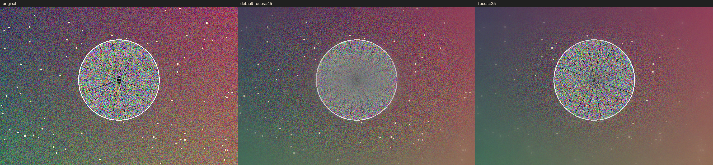

# 项目检查报告

## 2026-11-18 当前源码检查

检查对象为 1.2.0「光荣和平」及其未发布变更。范围包括 Windows 启动与打包入口、应用源码、图像处理、模型读写、会话、界面和项目自有文档。历史性能数据见[修复记录](修复记录.md#性能与回归)。下半篇保留 2026-10-18 源码快照的独立测量。

### 功能与资源

| 检查范围 | 方法与结果 |
| --- | --- |
| 启动与依赖 | 在隔离配置目录运行源码入口 `app/main.py --selftest`，窗口初始化与工作线程退出成功。环境为 Windows、Python 3.12.14、PySide6 6.12.0、OpenCV 5.0.0、NumPy 2.3.5、Pillow 13.0.0。 |
| 渲染与文件 | 使用照片运行普通和高性能光斑模式，各覆盖中心、手动和深度图对焦。检查 RGB 合成、透明图层复合、PNG / JPEG 读写、16 位 PNG / TIFF 深度图和 JPEG 深度图往返。工作区导出按钮到文件的链路通过。[工作区检查](../tools/check_workspace.py) |
| 会话与历史 | 13 项会话检查通过，覆盖正常恢复、原图缺失或被替换、损坏快照和写入失败后保留原记录。[会话检查](../tools/check_session.py) |
| 模型 | 修复 V2 输入与模型设备不一致，以及续传残片可能被误判为完整权重的问题。5 项离线测试通过，覆盖 CPU / CUDA 两种设备替身、推理尺寸回退及异常续传响应。[模型检查](../tools/check_depth_worker.py) |
| 构建配置 | 核对目录版、单文件版各自的轻量与 AI 配置，验证入口、图标、主题、页面素材、README、更新日志和许可证路径。构建按路径收集主题模板和图标。 |
| 文档与设计资源 | 15 份自有 Markdown 无整份重复。184 处本地链接和图片引用均可解析，其中 41 处章节引用与目标标题匹配。17 项原始交互答复逐行一致。原稿指纹、页面图层、设计参数、可编辑流程图及模拟图解通过校验。[文档索引](README.md) |

### 浅色界面核对

以设计稿三个画板及后续确认的运行规则为依据。Qt 离屏测试覆盖 100%、150%、200% 三档缩放；另在 1024 × 768 至 2560 × 1080 的七种窗口尺寸检查工作区布局。尺寸按逻辑像素记录。

| 部位 | 发现与处理结果 |
| --- | --- |
| 参数卡片与浮动窗口 | 二级窗口样式曾把 15 px 粗体分组标题、12 px 参数标签和 10 px 辅助文字覆盖为 13 px，镜头复选行缩至 15 px。现沿用卡片字阶与 26 px 行高。核对内嵌、浮动与归位三种状态的实际字体和控件几何。 |
| 直方图与照片信息 | 保留预览同款浅灰底、白色柱条和空图留白。照片信息条保留原稿浅蓝底，11 px 文字改为深蓝，对比度由 2.75∶1 提升至 5.23∶1。检查包括实际截屏取色及 R、G、B 切换。[统计区截图](../design-system/baoyue-bokeh/pages/workspace-histogram.png) |
| 导出与提示窗口 | 序号保持白字、灰底及原稿矩形，字重 700、至少 19 px，对比度由 2.52∶1 提升至 3.19∶1。错误、警告等消息级别标签采用 12 px 粗体。[导出示例](../design-system/baoyue-bokeh/pages/export-completion.png) |
| 软件内帮助 | 截图曾按原始像素宽度绘制，长命令也会撑宽整篇文档。现按正文可用宽度等比显示图片，命令可自动换行。460、720、800 px 宽的阅读窗口均可看到完整截图。验证了章节定位、返回上一页，以及安装目录缺少源码资料时保留当前页面。 |
| 键盘焦点（现存差异） | 光圈下拉框、虚化强度数值框及帮助按钮获得键盘焦点时，变化像素均位于控件边界内，外侧 3 px 无变化。规范要求独立的 4 个设计单位外环，在工作区约为 1.33 个逻辑像素。键盘操作可用，轮廓位置尚未统一。[描边与状态规范](../design-system/baoyue-bokeh/VISUAL-SCALE.md) |

工作区 16 组集成检查及卡片滚动 10 组检查通过。欢迎页覆盖分层布局、按钮命中、两段打字及会话导航。导出完成页覆盖长路径、显式定位和 `EXIT` / `NEXT` / Esc 的返回行为。[欢迎页检查](../tools/check_welcome.py) · [卡片滚动检查](../tools/check_card_motion.py) · [直方图检查](../tools/check_histogram.py) · [二级窗口检查](../tools/check_dialogs.py)

### 环境与覆盖边界

本工作副本的 `.venv` 引用的 Python 3.11 解释器无法启动，直接运行现有启动脚本会停在环境检查。以上检查使用可用的 Python 3.12 及本地兼容依赖，未重建用户环境。真实显卡推理、在线权重下载、实体显示器观感和新 EXE 的运行未在本轮验证。打包配置验证不生成安装包。

## 2026-10-18 早期源码快照

- **检查对象**：2026-10-18 的项目源码快照（8 个源文件）。
- **检查时间**：2026-10-18
- **运行环境**：Windows，Python 3.11.9，PySide6 6.12.0，OpenCV 5.0.0.93，NumPy 2.4.6，CPU（无 CUDA）
- **检查方法**：逐行代码审查 + 在临时虚拟环境中安装依赖并实际启动 GUI（offscreen 模式）+ 引擎量化测试（清晰度、耗时、峰值内存）+ 文件路径与线程生命周期复现实验
- **未覆盖**：torch / transformers 体积过大未安装，AI 深度估算只做了代码审查与“缺少依赖”时的降级测试；未在真实显示器上评估观感

---

### 当时的结论

该快照支持无 AI 依赖启动、导入、预览与导出。检查识别出三项阻断级问题：中文路径读写失败、默认中心对焦使主体失焦、原尺寸导出未传入有效深度图。另记录线程生命周期、手动对焦及预览性能问题。

在该次测试中，1400 像素预览单次 GUI 渲染约 375 ms，24 MP 导出峰值内存约 4.1 GB。上述数据仅用于说明被检查版本的行为。

---

### 一、阻断级问题（P0）

#### P0-1　中文路径下无法读图/写图（默认导出名含中文）

**位置**：`main.py:218`（历史行号）（`cv2.imread`）、`main.py:338`（历史行号）（`cv2.imwrite`）、`main.py:317`（历史行号）（默认文件名 `伯爵大光圈效果.png`）

在该 Windows 环境中，OpenCV 5.0.0.93 直接按路径读写时出现以下结果。

| 目录 | 文件名 | `imwrite` 返回 | 目标文件是否存在 | `imread` |
|---|---|---|---|---|
| ASCII | ASCII | `True` | 是 | 正常 |
| **中文** | ASCII | **`False`** | 否 | 失败 |
| ASCII | **中文** | **`True`（假成功）** | **否**（写到了乱码文件名） | 失败 |
| **中文** | **中文** | **`False`** | 否 | 失败 |

实测后果：

1. 向含中文的目标目录导出时，`cv2.imwrite` 返回 `False`，界面报告写入失败。
2. 在 ASCII 目录使用中文文件名时，`imwrite` 返回 `True`，但生成的文件名与指定名称不一致。
3. 读取含中文路径或文件名的图片时，`imread` 返回 `None`，界面将路径读取失败报告为格式错误。

界面导出测试使用 2400 × 3840 图像。中文目标路径处理耗时 2.8 s，`cv2.imwrite` 返回失败；改用 ASCII 临时路径后生成 1.46 MB PNG。

**修复**（读、写都改，约 10 行）：

```python
# 读
data = np.fromfile(path, dtype=np.uint8)
image = cv2.imdecode(data, cv2.IMREAD_COLOR)

# 写
ok, buf = cv2.imencode(ext, bgr, params)
if not ok:
    raise IOError("编码失败")
buf.tofile(path)
```

`np.fromfile` / `ndarray.tofile` 走 Python 的文件系统编码，中文路径正常；`imdecode` / `imencode` 只处理内存数据。已在同一台机器上验证可行。

---

#### P0-2　默认“中心对焦”把主体虚化，清晰区是一条环带

**位置**：`engine.py:36-42`（历史行号）（`_center_depth`）、`engine.py:44-50`（历史行号）（`_make_coc`）、`main.py:133-135`（历史行号）（焦点默认 45）

`_center_depth()` 返回“到画面中心的距离”（中心 0.05，四角 0.95），`_make_coc()` 用 `abs(depth - focus)` 计算虚化量。默认 `focus=0.45` 时，**中心（主体）离焦平面 0.40，反而被模糊；清晰区是半径约 0.3 的一圈环带**。

实测（800×600 合成场景，Laplacian 方差保留率，相对原图）：

| 焦点滑块 | 中心主体保留 | 环带保留 | 结果 |
|---|---|---|---|
| 0 | 24.7% | 0.7% | 中心较清晰，背景显著失焦 |
| 0.05 | 39.7% | 1.3% | 同上 |
| 0.25 | 80.7% | 21.7% | 中心最清晰 |
| **0.45（默认）** | **23.3%** | **87.6%** | **主体被虚化，环带清晰** |
| 0.70 | 0.8% | 18.0% | 中心显著失焦 |
| 0.95 | 0.5% | 0.7% | 中心和边缘均显著失焦 |



左：原图；中：修复前默认 focus=45（中心主体明显发灰、细节丢失）；右：focus=25（主体恢复清晰）。

补充：

- `_center_depth(self, h, w, focus)` 的 `focus` 参数**从未被使用**，说明这个函数本来还打算做“按焦点塑形”，但没写完。
- 即使把滑块拉到 25，中心也只有 80.7%，因为径向深度在整个主体圆盘内持续上升，圆盘边缘仍被判定为失焦。
- AI 模式的视差值越大表示越近。该快照未自动选择焦点，固定的 `focus=0.45` 可能偏离主体深度。

**建议**：中心模式改成单侧公式，例如 `coc = clip((depth - focus) / (1 - focus), 0, 1)`，让“焦点”表示清晰半径，默认 0；AI 模式在首次估算后自动把 `focus` 设为画面中心区域的中位深度，或补上“点击预览取样深度”的手动对焦。

---

#### P0-3　全分辨率导出未使用 AI 深度图

**位置**：`main.py:330-335`（历史行号）、`engine.py:87-88`（历史行号）

```python
if self.depth is not None and full.shape[:2] == self.original.shape[:2]:
    depth = self.depth
...
out = self.engine.process(full, depth, self.settings(), mode=mode)
```

当预览尺寸与导出尺寸不同时，旧实现将 `depth` 置为 `None`，渲染器回退至中心径向深度。界面未报告该回退状态。

GUI 实测：原图 2400×3840，`self.depth` 形状 (625, 1000)，导出时传给引擎的 `depth` 为 `None`，`mode=0`。

**修复建议**：按目标尺寸缩放深度图后传入渲染器，或按原图尺寸重新估算深度；状态栏显示实际对焦模式。

---

### 二、主要问题（P1）

#### P1-1　未导入图片时连续切换“显示原图”会抛 AttributeError

**位置**：`main.py:271-272`（历史行号）、`main.py:280`（历史行号）

`self.processed` 只在 `render()` 里赋值，`__init__` 没有初始化。启动后直接点“显示原图”：第一次 `checked=True`，走 `set_image(None)`，没事；第二次 `checked=False`，读 `self.processed` → **`AttributeError: 'MainWindow' object has no attribute 'processed'`**。真实 Qt 环境已复现。

修复：`__init__` 里 `self.processed = None`，`toggle_original` 里判空。

---

#### P1-2　AI 运行中关闭窗口 → 进程 fail-fast

**位置**：`main.py:286-297`（历史行号）（`DepthWorker` 无 parent、未处理 `closeEvent`）、[depth_worker.py](../app/depth_worker.py)

AI 推理在工作线程里，用户点关闭时 `MainWindow` 先销毁，`QThread` 对象被回收，Qt 打印：

```
QThread: Destroyed while thread '' is still running
```

实测退出码 `-1073740791`（`0xC0000409`），进程直接 fail-fast。模型下载/推理越久，越容易遇到。

修复：重写 `closeEvent`，先 `requestInterruption()` / `wait()`（或提供取消），并给线程设置 parent；不要在 `run()` 里做不可中断的长阻塞。

---

#### P1-3　“手动焦点（点击预览）”没有实现

**位置**：`main.py:129`（历史行号）（下拉项）、`main.py:278-280`（历史行号）

下拉框第三项写着“手动焦点（点击预览）”，但：

- `ImageCanvas` 没有 `mousePressEvent`，点预览没有任何反应；
- `engine.process()` 把所有 `mode != 0` 都当作中心对焦，`mode=1` 和 `mode=2` 输出**逐字节相同**（已实测 `np.array_equal` 为 `True`）。

建议：要么实现“点击位置 → 读取该点深度 → 设为 focus”，要么从界面上删掉，避免误导。

---

#### P1-4　滑块同步渲染耗时 0.2–2.7 秒并阻塞界面线程

**位置**：`main.py:113-147`（历史行号）（5 个滑块都直连 `render`）、`main.py:274-284`（历史行号）

`valueChanged` → `render()` → 在界面线程同步执行整条渲染流程（四次高斯模糊及光斑叠加），未对连续输入防抖。

实测（本机 CPU）：

| 预览 | 单次 render |
|---|---|
| 1000px（默认） | 181 ms |
| 1400px | 375 ms |
| 原尺寸 3840px | **2654 ms** |

拖动滑块会堆积大量 `valueChanged`，1400px 下约 2.7 FPS，原尺寸预览的单次同步操作可能超过 2 秒。

---

#### P1-5　24 MP 导出峰值内存超过原文档配置建议

**位置**：`engine.py:99-110`（历史行号）、`engine.py:52-81`（历史行号）

`process()` 里保存了 `base`、`result` 两份 float32 全图，`_bokeh_overlay()` 又生成 `f`、`result`、`glow`、`warm`、`highlights`、`dilated` 等多份 float32 全图。24MP 时每份 RGB float32 约 288 MB。

实测峰值工作集（`GetProcessMemoryInfo`，纯色图，属于偏乐观估计）：

| 像素 | 耗时 | 峰值内存 |
|---|---|---|
| 6 MP | 1.5 s | 1066 MB |
| 24 MP（4000×6000） | 6.6–7.0 s | **4106 MB** |

8 GB 机器在导出 24MP 时很可能触发换页甚至 `MemoryError`。README 的“4 GB 以上内存”建议需要改成 8–16 GB，或做分块处理。

---

#### P1-6　“暖金光斑”实际效果是整体变暗，几乎不加暖色

**位置**：`engine.py:73-80`（历史行号）

```python
result = result * (1 - 0.16 * w) + (result * 0.75 + warm * 0.25) * (0.16 * w * clip(glow, 0, 1))
```

- 无高光（`glow=0`）时：`result *= 0.84`，整幅图**暗 16%**，没有任何暖色。
- 即使 `glow=1`、`w=1`：系数变成 `0.84 + 0.16*0.75 = 0.96`，只混入 4% 的暖色。

实测（纯灰 128）：

| 光斑 | 暖金 | 输出均值 |
|---|---|---|
| 1.0 | 0.0 | 128.0 |
| 1.0 | 0.25 | 122.0（暗 4.7%） |
| 1.0 | 1.0 | 107.0（**暗 16.4%**） |
| 0.0 | 1.0 | 128.0（**完全无效果**） |

另外 `engine.py:53-54`（历史行号） 在 `bokeh_strength<=0.001` 时直接返回，所以“光斑强度”为 0 时“暖金”滑块完全失效，两个滑块被隐式耦合。

---

#### P1-7　AI 任务缺少完整状态校验

- **每次点击都重新构造 pipeline**（`depth_worker.py:22-26`（历史行号）），模型会重新加载；没有缓存、没有进度、不能取消，下载卡住时按钮会一直处于“正在估算…”禁用状态。
- **换图/换预览尺寸时旧任务不会取消**：`reload_preview_size()` 把 `self.depth=None`（`main.py:241`（历史行号）），但 worker 仍在跑；它完成后 `ai_finished()` 会把**旧图**的深度赋给**新图**。
- **AI 模式没有深度时静默退回中心对焦**：`render()` 传 `depth=None, mode=0`，`engine.process()` 直接走 `_center_depth()`；界面仍显示“AI 自动估算”，只有切换模式时才会提示一句。
- 切换预览质量后清除了已有深度结果，界面未明确显示深度结果失效的状态。

建议：缓存 pipeline；用 `request_id` 或图像指纹校验结果；AI 模式无深度时禁用渲染或明确提示；切换预览质量后自动按新尺寸重算。

---

### 三、次要问题（P2）

1. **窗口最小宽度 1289 px > 默认 1280 px**：`minimumSizeHint` 实测 1289×519，两个 480px 画布 + 285px 控制栏导致 1280 宽窗口已经挤压；在 1280×720 的老笔记本上会横向裁切。1280×800 下右下角的提示文字也显示不全。
2. **高 DPI 预览清晰度下降**：`ImageCanvas._refresh()` 按 `self.size()`（DIP）缩放 QPixmap，没有设置 `devicePixelRatio`。实测窗口 DPR=1.5 时 pixmap DPR=1.0、尺寸 640×400，Qt 会把它放大 1.5 倍绘制，125%/150% 缩放下预览清晰度下降。
3. **忽略 EXIF 方向**：`cv2.imread` 不旋转，手机竖拍照片可能横着显示；也没有处理 Alpha、16-bit、ICC 色彩配置。
4. **导出扩展名与文件类型不一致**：`selected` 过滤器参数未使用（`main.py:316`（历史行号）），用户选 JPEG 但文件名不带扩展时，代码一律补 `.png`。
5. **依赖未锁定**：`opencv-python>=4.9` 在该次检查中解析为 OpenCV 5.0.0.93；`transformers>=4.44` 无上限，未来 5.x 可能破坏 `pipeline("depth-estimation")`。
6. **AI 依赖默认是 CPU 版 torch**：`requirements-ai.txt` 从 PyPI 装 `torch`，Windows 下通常是 CPU wheel，`torch.cuda.is_available()` 为 False，README 说的“优先 CUDA”不会自动发生；CUDA 版需按 PyTorch 官方选择器安装。
7. **启动脚本固定使用 `py -3.11`**（历史 `run_windows.bat:5`）：Microsoft Store 安装的解释器未被启动器识别。环境创建和激活失败后，脚本仍继续执行安装，可能写入系统 Python。历史脚本在每次启动时调用 `pip install`，离线时可能无法完成。
8. **代码卫生**：`engine.py` 的 `math`、`main.py` 的 `QThread, Signal` 未使用；`_center_depth` 的 `focus` 参数未使用；`image_path`、`selected` 赋值后未使用；`mode` 用 0/1/2 魔法数字；没有测试、没有 `.gitignore`、没有图标/版本信息。
9. **README 与实现不一致**：“实时调整”（实测 0.2–2.7 s/次）、“4 GB 以上内存”（24MP 实测 4.1 GB）、“自动检测 CUDA 并回退 CPU”（实际只做标签检测，所有算子都在 CPU；“CUDA 可用（部分算子）”的文案容易让人误解）。

---

### 四、实测数据汇总

**清晰度保留率**（相对原图，Laplacian 方差；默认参数，中心对焦模式）：

| 指标 | 数值 |
|---|---|
| 中心主体保留 | 23.3% |
| 环带保留 | 87.6% |

**耗时**（CPU，默认参数，单次 `process()`，取两次最小值）：

| 尺寸 | 耗时 |
|---|---|
| 1000×563 | 222 ms |
| 1400×788 | 465 ms |
| 1920×1080 | 757 ms |
| 4000×3000（12MP） | 4517 ms |
| 6000×4000（24MP） | 7999 ms |

**GUI 内单次 render**：1000px 181 ms / 1400px 375 ms / 3840px 2654 ms。

**峰值内存**：6MP 1066 MB；24MP 4106 MB。

**其他**：

- `mode=1` 与 `mode=2` 输出逐字节相同。
- 暖金滑块：128 → 107（warm=1, bokeh=1）；bokeh=0 时无效果。
- 中文路径矩阵见 P0-1。
- AI 运行中关闭：`QThread: Destroyed while thread is still running`，退出码 `0xC0000409`。
- 未打开图片点两次“显示原图”：`AttributeError: 'MainWindow' object has no attribute 'processed'`。
- `py_compile main.py engine.py depth_worker.py` 通过，无语法错误。

---

### 历史问题跟踪

问题编号与修复验证按当时版本归档。[修复清单](修复记录.md#修复清单) · [修复前后数据](修复记录.md#实测回归) · [对焦比较图](images/检查-修复前对焦对比.png)
