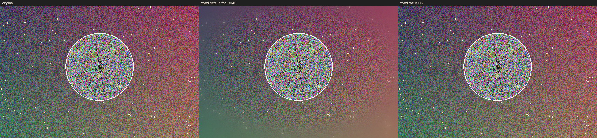

# 实现与修复记录

| 版本 | 集中修改 |
| --- | --- |
| v1.2.5 现代主义 | 11 月 16–18 日的浅色工作区、分层适配、导出窗口、直方图和界面复查 |
| v1.2.4 一阳来复 | 11 月 15 日的欢迎页、会话恢复及配套设计文档 |
| v1.2.3 惟精惟一 | 光斑参数范围、数值输入和编辑区域修复 |
| v1.2.2 游刃有余 | 渲染性能、预览调度及遮罩优化 |
| v1.2.1 浮光跃金 | 高性能光斑的波前扩散、离焦分层及反光源估算 |
| v1.2.0 光荣和平 | 10 月 31 日的主题、动画及浮动窗口。阶段编号 v1.2.0-dev.1–dev.3 |
| v1.1.1 诗人革命 | 10 月 20 日的预览交互、历史、直方图与使用报告。阶段编号 v1.1.1-dev.1–dev.3 |
| v1.1.0 天工开物 | 10 月 19–20 日的光学与模型迭代、异步渲染及构建发布。阶段编号 v1.1.0-dev.1–dev.5 |
| v1.0.0 周武维新 | 10 月 19 日的首版功能基线。阶段编号 v1.0.0-dev.1 |

各开发阶段的编号、名称及用典见[更新日志](../CHANGELOG.md)。

## 2026-11-18 文档、浅色界面与模型读写

- 限定通用窗口样式的作用范围。浮动卡片保留参数面板字号和行高，归位操作使用工作区按钮。校正照片信息条与导出序号的前景／背景对比度，记录源稿色与运行色。
- 帮助窗口按可用宽度显示文档图片，长命令支持折行。文档链接可定位到章节并返回上一页，访问未随包分发的源码资料时保留当前位置。用户操作、发布流程、设计依据和历史测量分别归入各自主文档。
- V2 预处理批次在推理前移动至模型设备。模型续传核对响应区间、字节数及总长度，确认完整后再替换目标文件。打包脚本按路径收集主题模板和图标，保留源码、虚拟环境和同步副本的缓存。
- 对应界面测量、测试入口、环境限制与现存焦点轮廓差异见[当前源码检查](代码检查报告.md#2026-11-18-当前源码检查)。

## 2026-11-17：顶部统计区与通道直方图

- 直方图底色统一为预览占位区域的浅灰色 `#E6E6E6`，柱条保持白色；未导入图片时不绘制提示文字，保留空白统计区域及禁用的通道按钮。
- 浅色参数卡片顶部此前由 `_Metadata.paintEvent` 读取 `before_canvas._pixmap` 并按覆盖比例绘制照片，既未连接直方图组件，也未使用像素统计。这是照片出现在统计区域的直接原因。现将上方内容替换为共享直方图，原拍摄信息条继续按 EXIF 四列或尺寸、格式两列显示；源稿锚点和外框测量保持独立记录。
- 增加共享 `HistogramModel`，一次统计当前预览图的 256 档亮度、红、绿、蓝计数，支持亮度和三个单通道视图。亮度沿用 `cv2.COLOR_RGB2GRAY` 的编码值换算，不将其表述为线性光亮度；RGB 计数直接来自预览 RGB 字节。浅色顶部、黑夜卡片及独立窗口共用计数与当前通道，切换通道不重新统计。
- 通道入口仅保留图表右上角的 R / G / B 方形按钮，尺寸 26 × 26 逻辑 px、圆角 5 px、间隔 6 px，距顶边和右边各 6 px；常态黑底 `#262626` 白字，选中蓝底 `#001EFF` 白字。三个按钮互斥，点击已选按钮取消，全部未选时回到亮度；模型键分别为 `luminance`、`red`、`green`、`blue`。
- 图表统一灰底白条，不显示标题、坐标文字、通道说明和图例；窗口标题及菜单仍为「图像直方图」。内部统计范围为 0–255，柱高按当前通道峰值归一化。统计随有效处理结果更新，原图对比时使用原图，效果范围红色显示层不参与统计。无图或撤销至空图时清空计数和照片信息，禁用通道按钮，重新导图后恢复操作并保留通道偏好。
- `tools/check_histogram.py` 三按钮专项在 100% / 150% / 200% 缩放下通过，验证原始及分块 RGBA 精确计数、互斥与再次点击取消、按钮几何和状态色、跨视图同步、原图对比、范围标记排除、浮动及主题往返和空图恢复。界面截图见[工作区顶部统计](../design-system/baoyue-bokeh/pages/workspace-histogram.png)和[四种通道状态](../design-system/baoyue-bokeh/pages/histogram-channels.png)。下方 2026-11-16 的缩略图描述为当时实现记录，本节取代其作为当前顶部内容定义。

## 2026-11-17：欢迎页标题时序与卡片滚动

- 欢迎页标题采用两阶段状态：逐字显示「伯爵大光圈」，首句完成后按实际时间保留 3000 ms，再清空并逐字显示「今天我们要模拟什么」；完成后在文本末尾以约 500 ms 间隔切换竖线光标。停留时间不受全局动画速度缩放，第二句字号按原品牌文字矩形适配，黑色品牌条及菱形装饰保持原几何。
- 动画总开关或标题开关关闭时，直接显示静态第二句和常显白色光标，停止闪烁定时器。等待及逐字完成状态停止高频打字更新；3 秒等待使用单次定时器，动态光标使用低频定时器。隐藏页面或开始导航时取消待触发状态，避免离开后更新隐藏标题。该时序取代早期单句完成即停止全部标题更新的调度方式。
- 卡片滚轮使用 easeOutCubic 曲线，连续滚轮输入在目标位置上累积，并按滚动范围限制；触控板的 `pixelDelta` 直接跟随。滚动条拖动、分组定位等外部位置修改以及隐藏部件会取消未完成目标，避免缓动覆盖明确操作。浅色参数卡片、浮动窗口及黑夜控制总区复用同一规则，遵循动画总开关、速度与更新间隔；禁用动画后直接应用滚动位置。
- 「焦点景深」附加参数展开采用 OutCubic 缓出曲线，沿用已有动画配置。展开后的分组定位会取消旧滚动目标，避免滚轮动画将内容移出刚定位的位置。
- 滚动控制器跟踪当前有效的 Qt 滚动条及视口，在对象替换后重建事件及信号绑定；窗口销毁期间停止定时器，避免浮动归位后访问已失效的 C++ 对象。专项检查覆盖滚动条替换、已销毁对象取消，以及完整参数卡片反复浮动、归位后的滚轮与显式定位。
- `tools/check_card_motion.py` 的 10 组专项与完整工作区的 16 组集成回归均在 100% / 150% / 200% 缩放下通过，统一二级窗口检查通过；欢迎页和直方图专项也覆盖相同三档缩放。首句及布局参考见[欢迎页](../design-system/baoyue-bokeh/pages/welcome.png)，提示语状态见[欢迎页提示](../design-system/baoyue-bokeh/pages/welcome-prompt.png)。

## 2026-11-16：欢迎页分层、导出结果与二级窗口

- 欢迎页将 UI 比例与场景比例分开：品牌、START、NEXT 分别锚定左下、右下、右上；场景及两条圆形几何按窗口高度等比缩放，底部与品牌区关联，窄窗口裁切横向溢出。波纹、结构线和蓝色底座独立适配，取消整页居中产生的上下空带。缓存按窗口尺寸及 DPR 重建，绘制与按钮命中共用锚点；原有逐字、渐显、悬停及静止停表继续生效。
- 从 PDF 第 2 页提取完成标题、按钮、点阵及插图，显示实际工作区的模糊快照和半透明遮罩。插图采用保留 alpha 的灰阶转换；文件地址为完整可选文字，支持复制、折行、滚动及显式定位，序号随机 0–9。EXIT 返回欢迎页，NEXT / Escape 返回当前工作区，图片、深度、参数及进程内历史不重建；透明图层说明保留。跟随主窗口移动及缩放，渐显遵循动画设置。
- 新增统一纸面窗口容器，接入导出设置、模型导入、动画设置、项目说明、直方图、浅色及黑夜浮动窗口和消息。标题支持移动，右下手柄调整尺寸；消息正文为纯文本并可选择，保留 QMessageBox 标准按钮返回值。确认与取消置于正文滚动区之外，避免长内容遮蔽操作。系统文件选择器保留系统样式。
- START、欢迎页 NEXT、IMPORT、EXPORT、完成页 EXIT / NEXT 使用白色字形填充，资源提取时抑制蓝色字形轮廓绘制，不改写 PDF。按钮外框、阴影及运行键盘焦点环保留；品牌与展示标题仍使用原稿轮廓。
- 纸面浮动窗口预留左右各 36 px 外壳，完整参数窗口最小宽度由 326 调整为 398 px（302 px 面板、24 px 内容留白及 72 px 外壳），保持 267 px 表单和独立滚动列。此约束替代下方早期浮动窗口宽度记录。
- 检查覆盖六张英文操作资源的蓝色像素排除、导出设置值及格式约束、模型输入、四类长文本消息、底部操作可见性、完成页导航和会话保留；窗口及工作区在 100% / 150% / 200% 缩放验证。欢迎页检查七种比例、命中锚点、键盘导航、冷 / 温恢复和动画停表。源尺寸运行绘制与当前静态图层重组的平均通道差约 0.2833 / 255，来自分层矢量及纹理独立采样；不与下方旧整页适配的误差直接比较。
- 当前实现截图及设计参数同步至设计目录，更新日志记录为未发布源码变更。本轮未重新构建 EXE。

## 2026-11-16：伸缩卡片、预览分区与参数可见性

- 右侧历史与参数卡片保持逻辑宽度，默认高度延展至主操作实体顶边上方 22 px。底部手柄分别调整高度比例，窗口变化时按可用高度重新计算并限制在最小高度及主按钮边界之间。历史最小高度 380 px、参数最小高度 340 px；历史新增高度分配给列表，设置至报告操作整组下移，参数新增高度分配给滚动视口。面板统一采用九宫格绘制，保留圆角、描边、阴影及顶部装饰。
- 卡片支持拖动、方向键 8 px、Shift 加速 32 px、Home 收短和 End / 双击恢复自动高度。高度偏好分别保存在 `workspace/historyHeightRatio` 与 `workspace/parametersHeightRatio`，与处理参数历史分开。浮动时隐藏主页面手柄，使用原生窗口边缘调整大小，归位时恢复当前主窗口的受限高度。
- 预览增加两条沟槽分隔手柄，分别调整原图与右列的宽度比、效果图与深度图的高度比。默认保留源稿矩形及内缩，调整使用现有画布或浮动占位，不重建像素图。支持拖动、方向键 8 px、Shift 加速 24 px、Home / 双击单轴复位及拖动中的 Escape 取消；释放或键盘操作结束后保存比例。最小区域宽 96、高 80 px，紧凑视口按可用空间缩减约束。
- 浅色图片支持普通滚轮以光标为锚点缩放、普通中键平移、双击容纳完整图像，以及右键放大、缩小、适应、预览像素 1:1、重置视图和还原分区。各画布独立保存视图，调整分区不修改缩放和平移。1:1 表示当前预览像素与逻辑像素的对应，预览质量仍决定采样分辨率；黑夜操作方式保持不变。
- 复现并修正浮动参数卡片的横向裁切：原 300 px 窗口内面板约 276 px、视口 241 px，固定表单为 266–267 px，禁用横向滚动后右端输入及按钮超出视口。现固定表单 267 px、面板最小宽 302 px、浮动窗口最小宽 326 px，完整保留内边距及竖向滚动条。焦点标题使用 `▸ / ▾` 标识展开状态，显式展开后一次性滚动定位该分组，普通状态同步不重复改变滚动位置。
- 工作区集成检查增至 16 组，100% / 150% / 200% 缩放均通过：验证卡片自动增长、真实拖动与边界、按钮组重排、分区鼠标及键盘操作、浮动占位归位、缩放菜单与滚轮 / 平移、冷启动偏好恢复，以及全部参数控件逐项进入视口。浮动窗口请求缩到 300 px 时会限制为至少 326 px，未再出现右端裁切；原有对焦、历史、主题、离线 AI 状态和 RGB / RGBA 文件导出回归保留。

## 2026-11-16：表单网格与分层背景

- 将浅色参数表单收敛为共同列：分组左右内边界 18 逻辑 px，标签列 58 px，列间隔 8 px，下拉框及可见滑轨从分组 x = 84 开始，数值框与输入共用右边界。数值槽按最长合法文本保留至少 44 px，滑块极值手柄与数值之间保留间隔；整数、负数、小数和百分比变化不改变列宽。
- 下拉框、标题及数值框统一 26 px 高，滑块行 30 px、行间隔 8 px；普通按钮按字体度量保留左右各 10 px、上下各 3 px。窄宽度中的长标签根据实际换行增高；设置、报告及预览质量分别采用适配文字的胶囊外框。历史设置面板的主按钮、列表及信息行共用左右 14 px 的边界，浮动缩放后重新排列。
- 镜头虚化常驻光圈、虚化强度、光斑强度、形状、密度、大小、高性能模式、球差、猫眼、高光补偿及阈值共 11 项控制，不再通过标题隐藏。焦点附加功能保留展开行为。完整参数仍绑定既有状态，未增加第二套渲染参数。图片拍摄信息使用四等分列，缺失字段保留空列；无 EXIF 时回退为尺寸和格式两列。相机装饰移至滚动内容末尾，避免与参数重叠。
- 背景新增独立图层清单及绘制模块：左侧红带保持逻辑宽度并延伸至窗口底部，顶部参考线保持线宽及上边距，右上方块保持尺寸和锚点；左右波纹按窗口高度等比缩放、贴边裁切，超宽窗口内侧边缘渐隐；底部蓝色几何使用固定两端与横向延展中央段，保留斜边坡度及垂直渐变。底栏继续独立绘制。运行时只分配三张波纹及渐变图，结构线使用源几何绘制，复用原有按设备像素比缓存的静态底面。
- 页面栈改为按当前页计算最小尺寸，解除隐藏黑夜页面对浅色窗口约 1173 px 最小宽度的约束。浅色工作区最小尺寸为 900 × 640 逻辑 px，参考构图为约 1365.333 × 720；普通缩放保持右侧控制面板尺寸，主操作保持上层。黑夜页面继续使用自身原有布局约束。
- `tools/check_workspace.py` 增加共同列、文字留白、镜头参数常驻、合法边界及浮动缩放检查，现为 13 组集成检查；100% / 150% / 200% 缩放分别验证。另检查 1024×768、1100×850、1280×800、1366×720、1600×900、1920×1080、2560×1080 七种逻辑窗口尺寸，确认隐藏页面不阻止缩放，固定面板与主操作基线保持。主题往返后复核 1024×768 尺寸恢复。
- 独立背景在相同七种尺寸下生成预览，源比例回绘（不含底栏）的平均绝对通道差为 0.1195 / 255，差值超过 8 的像素占 0.0282%，主要来自矢量边缘的独立栅格化；非零视口原点及裁切边界检查通过。背景源 PNG 的尺寸、透明通道、SHA-256 与原 PDF 哈希检查通过。截图见[完整镜头参数](../design-system/baoyue-bokeh/pages/workspace-lens.png)及[超宽工作区](../design-system/baoyue-bokeh/pages/workspace-wide.png)。

## 2026-11-16：浅色工作区与状态绑定

- 按 `排版.pdf` 第 3 页提取背景、面板、标签、主操作及装饰共 12 层资源，记录源文件 SHA-256、4096 × 2160 画板及精确矩形。运行端按 1/3 换算为逻辑坐标，基准约 1365.333 × 720；右侧历史设置和参数面板保持逻辑尺寸，预览框采用分段拉伸保留圆角、阴影和装饰点，背景保持原始宽高比。
- 新增独立浅色工作区及原生控件绑定层。光圈、滑块、精确数值、复选框和模型列表双向连接既有编辑状态，处理引擎、渲染队列、历史及会话继续共用；模型数据和控件可用状态通过信号及单次事件合并更新，不增加轮询。补齐更纱黑体 SC 600 完整字体，普通参数使用实际 Semibold 字形。
- 参数分为「镜头虚化」和「焦点景深」，点击标题展开扩展控制。中栏「设置」菜单收纳原图对比、撤销、恢复、直方图和返回欢迎页；预览质量、主题、动画、帮助、效果范围及报告保持独立入口。底部 IMPORT / EXPORT 沿用原稿外框、文字和共同基线，绘制层级高于普通卡片。
- 三处预览共享既有像素图，各自保留缩放和平移。首次显示按视口覆盖比例建立图像基准，窗口尺寸变化后保持图像比例并裁切；焦点点击按裁切后的图像坐标映射。无图时为灰底与白色鸟群，信息区不显示示例数值、不接受交互；有图时显示缩略图及可用 EXIF，无 EXIF 时显示尺寸与格式。
- 原图、效果图、深度图、历史设置、完整参数面板、镜头组及焦点组支持非模态浮动。使用原生窗口移动与缩放，关闭或点击占位入口归位；切换主题、返回欢迎页前归位。历史恢复同时刷新浮动控件，修正其脱离页面子树后漏同步的问题；归位时还原滚动容器自动修改的背景填充属性，并约束参数组垂直伸展，防止底色遮挡及额外行间距。光圈和光斑形状修改补入历史提交。
- 缓存静态页面底面并按设备像素比重建，避免交互期间重复缩放背景图。保留主题模糊渐变、卡片倾斜、按下反馈、分组展开和鸟群；隐藏页停止空预览计时器。黑夜模式继续使用原有卡片布局。打包配置补入使用说明引用的页面截图，不新增运行时 PDF 解析依赖。
- `tools/check_workspace.py` 的 12 组集成检查通过，覆盖空图导出提示、参数双向同步及键盘输入、高性能范围、动态模型、历史、原图比较、裁切点击对焦、窗口适配、七处浮动及透明性归位、浮动时的历史恢复、离线 AI 状态、主题切换、实际 RGB / RGBA 文件导出，以及欢迎页温 / 冷恢复。AI 使用离线替身验证工作区状态路径，不代表重新执行真实模型推理或下载。欢迎页回归和会话数据 13 项回归通过。
- 在 Qt 离屏环境以 150% / 200% 缩放分别运行独立进程：Sarasa Gothic SC Semibold 匹配为真实 600 字重、参数字号 12 逻辑 px，22 个数值边界文本均适配编辑区域；七处浮动后归位、主按钮共同基线及折叠后的参数间距通过复核。修正局部按钮样式覆盖角色字号的问题，预览质量、报告与设置标题分别采用 8 / 11 / 15 逻辑 px。动画总开关关闭时，分组展开及收起直接设置完成状态。截图见[空工作区](../design-system/baoyue-bokeh/pages/workspace.png)及[图片工作区](../design-system/baoyue-bokeh/pages/workspace-photo.png)。
- 此阶段沿用原导出完成提示，后续接入记录见 2026-11-16 的导出结果一节。

## 2026-11-15：欢迎页与会话恢复

- 按 `排版.pdf` 首页的绘制对象拆分六层透明 PNG，分别保留背景、品牌条、RE 字标、中文品牌和两个按钮。原画板为 4096 × 2160，运行端对图层及点击区域使用同一等比居中变换；首次显示不出现编辑区控件，黑夜编辑主题偏好保持不变。
- 新增原生鼠标及键盘按钮，支持 Tab、Enter、空格和独立焦点外环；入场渐显、中文逐字揭示及悬停微移遵循已有动画配置。缩放时缓存背景，静止及隐藏时停止欢迎页动画，显示欢迎页时暂停编辑区鸟群。设备档案采集延迟至进入编辑区后执行，关闭后的延迟回调不再采集。
- START 进入空白工作区并沿用参数偏好，NEXT 恢复有效图片会话。进程内保留历史栈，跨启动保存图片路径、深度、模型及参数后建立新历史基线；返回入口位于「预览与输出」卡片。
- 会话采用单文件 NPZ、JSON 元数据和 float32 深度，写入使用临时文件与原子替换，不序列化原图或可执行对象。记录图像读取时的源文件签名，避免编辑期间原图被替换后将旧深度误认为适用于新图；丢失、变化或损坏均有降级路径。
- 独立资源重组与完整 PDF 首页同渲染器比较：最大通道差 3 / 255、平均绝对通道差 0.004436 / 255，差异来自透明图层的 8 位量化。源码尺寸下 QWidget 空闲绘制与图层重组的平均通道差为 0.000341 / 255。
- `tools/check_welcome.py` 验证启动、长宽比及命中区域、鼠标 / 键盘导航、温恢复历史、冷恢复图片与深度、扩展参数、源文件丢失及编辑期间替换、关闭欢迎页不覆盖缓存、逐字动画结束后停表，以及源尺寸图层一致性。`tools/check_session.py` 的 13 项数据回归通过；另验证 150% / 200% 系统缩放及黑夜主题偏好保留。
- 该阶段只接入首页。工作区与导出完成页的后续变更见 2026-11-16 记录。

## 高性能光斑与渲染性能

### 成像流程

当前算法的完整步骤、参数作用、公式和 PSF 样本统一见独立的[光斑模拟流程图解](simulation-guide/README.md)。本文件保留实现变更、修复方法与验证条件。高性能分支采用线性光扩散及深度 / 视场 PSF 插值，最终与焦内原图的混合发生在编码空间；普通分支保留三档背景 PSF 和独立高光层。

模型参考资料为 [OpticStudio 点扩散函数](https://optics.ansys.com/hc/en-us/articles/42661723066515-What-is-a-Point-Spread-Function)与[视场 PSF 插值](https://optics.ansys.com/hc/en-us/articles/42661994652819-How-to-simulate-high-resolution-images)。

参数范围与输入步长见[用户说明主表](../README.md#参数范围与精确输入)。扩展范围、软限幅、数值输入及超范围暂存参与操作历史和设置恢复；相关算法作用由模拟流程图解维护。

### 数值框布局

Qt 样式表为数值框绘制边框时，`NoButtons` 设置使内部编辑区域宽度缩减至约 1 像素。改为通过零尺寸箭头子控件隐藏按钮，并设置内部文字边距。离屏测试覆盖浅色、黑夜主题及 150% 缩放，验证整数、负数、小数和百分比的文字边界、输入提交与模式切换。

### 性能与回归

- 有效区域卷积保留完整核边界；使用单精度 OpenCV DFT 生成波前核，复用卷积缓冲区，并批量过滤无效反光候选。大图按通道进行线性光转换，按条带进行合成，减少全尺寸浮点中间图层。
- [`RenderWorker`](../app/main.py) 在渲染检查点取消过期预览，队列仅保留最新预览；导出按提交顺序执行并优先于排队预览。效果范围遮罩由 OpenCV 批量计算，与优化前逐像素一致。
- 下表采用同一台 Windows 设备、同一张项目示例照片、同一组参数比较优化前后的 CPU 渲染。预览为 1000 × 750；透明图层为 4096 × 3072，统计渲染与图层合成，不含 PNG 写入。时间为首次运行后的重复渲染中位值；峰值为进程工作集，遮罩单独测量。

| 测试项 | 优化前 | 优化后 |
| --- | ---: | ---: |
| 高性能光斑预览 | 1.41 s | 0.92 s |
| 透明图层渲染 | 3.13 s | 2.51 s |
| 透明图层渲染峰值工作集 | 1426 MiB | 703 MiB |
| 4096 × 3072 效果范围遮罩 | 约 631 ms | 约 29 ms |

- 性能优化前后的预览、透明图层和深度测试中，颜色与透明度最大差异为 1 个 8 位数值级。另验证 4096 × 3072 透明图层叠回原图与合成图的最大差异为 1 个数值级。
- 光学回归覆盖弱点光源、冷暖点光源重叠、长条光源、均匀区域和焦内区域。示例照片复测使用由截图重建的相对深度；该复测用于检查图像表现，不用于镜头标定。

## 2026 年 10 月归档

以下问题编号对应[早期源码检查](代码检查报告.md#2026-10-18-早期源码快照)。修复方法、控件名称、测量值及环境均按当时版本记录。

## 2026-10-19 背景卷积与高光叠加

- 背景虚化改为只在背景像素上做归一化卷积（clean plate），减少焦内主体颜色向背景扩散。

- 背景虚化从高斯改为按光圈形状 PSF 的 FFT 卷积（圆形/5–9 边形散景核），背景按选定的开口形状扩散。

- 光斑改为圆角多边形散景：圆形或 5–9 边形可选，密度可调，带柔边、亮边、猫眼压缩、偶发洋葱圈，并按前景掩膜遮挡；多个光斑改为加性叠加，重叠处变亮、混色。

- 移除“暖金光斑”选项；新增“光斑大小”30%–200% 调节。

- 光斑颜色改为参考背景环境色（排除高光和主体），避免白光源始终是纯白。

- 导出支持选择格式、分辨率、光斑抗锯齿（1×/2×/3×超采样）和 JPEG 质量；新增透明“大光圈效果图层”导出（RGBA PNG，主体区域透明）。

- 深度图增加常驻预览；导出目录增加可写性探测，沙箱或受保护目录自动回退到项目 `exports/`。

- UI 改为黄/黑/白配色。

- 性能（CPU，默认参数）：1000px 预览约 0.29 s，1400px 约 0.38 s，13.5MP 约 1.8 s，24MP 约 3.5 s（峰值约 2.6 GB）。

## 2026-10-19 球差模拟 + 后台渲染

### 新增：球差（Spherical Aberration）控制

该版本使用径向权重控制普通模式的光斑亮度分布。参数符号约定及测量结果如下。

- 引擎新增 `EngineSettings.spherical`（-1 \~ +1），对弥散圆/散景做**径向能量再分配**：

  - `>0` 欠校正 → 能量聚到边缘（边缘亮环、硬朗的“肥皂泡”散景）；

  - `<0` 过校正 → 能量聚到中心（中心亮、柔和的奶油散景）；

  - `0` 校正良好 → 均匀圆盘。

- 卷积 PSF 归一化后再使用，**总光量守恒**（球差是重新分配能量，不改变整体曝光）。

- 同时作用于两处：背景虚化的光圈 PSF（`_disc_kernel` / `_disc_blur_levels`）与高光光斑的绘制（`_bokeh_overlay`：欠校正加粗并提亮边缘、过校正压暗边缘并叠加亮心）。

- 界面在「镜头与虚化」新增「球差」滑块（-100 \~ +100，默认 0，带悬浮说明）。

- 实测：三种球差下 PSF 总和恒为 `1.0000`；径向质心 **欠校正 ≈ 0.77 > 校正 ≈ 0.65 > 过校正 ≈ 0.48**（均匀圆盘理论值 2/3），方向正确；出图形态 +1 亮环暗心 / -1 亮心暗边 / 0 均匀，与光学预期一致。

### 修复：渲染在主线程执行导致界面「无响应」

- **现象**：拖动滑块（尤其切到“高质量预览（原尺寸）”）、打开大图、或导出大图时界面线程阻塞，Windows 显示「未响应」。

- **根因**：`engine.process()` 全程在 Qt 主线程同步执行。实测单次耗时：1000px 预览 0.30 s、1400px 0.41 s、24MP 约 4.5 s；最坏（3000×2000 + 500 高光 + 3× 抗锯齿）5.3 s，24MP 导出外推 ≈ 20 s+。**与新增的球差无关**：开关球差前后 1000px 预览为 0.30 s vs 0.31 s，属噪声级。

- **修复**：`engine.process()` 移到独立 `RenderWorker(QThread)`；预览请求自动合并（只保留最新一条），导出请求排队不丢弃；导出等待改用嵌套 `QEventLoop` 并加 60 s 等待超时，等待期间 GUI 事件循环照常运转；关闭窗口时安全停止渲染线程，自检入口先 `close()`。

- **实测**：导出 1200×1800 结果正常；导出执行期间主线程定时器仍在触发（测得 19 次回调）→ 界面保持响应；透明图层导出返回 `(final, effect, alpha)` 三张；`python app\main.py --selftest` 退出码 0。

## 2026-10-19 AI 深度模型导入 + 联网获取

### 新增：前端导入 AI 深度模型

界面在「景深与主体」新增「导入 AI 模型」按钮，弹窗二选一：

- **本地模型文件夹**（HF 格式，含 `config.json` 与 `model.safetensors` 或 `pytorch_model.bin`）：直接使用该目录，不联网；

- **仓库 ID / 链接**：支持 `owner/name`、`https://huggingface.co/owner/name`、hf-mirror 链接，以及 `.../tree/main` 等模型页面链接，统一规范化为 `owner/name`。

导入的模型写入 `models/imported_models.json`（名称 + 引用），**下次启动仍然保留**。模型下拉框同时列出内置三档与导入项，并标注“已下载 / 首次需下载 / 本地可用 / 目录不可用”。

### 缓存命中、仓库回退与下载

- `resolve_model_path` 与 `ensure_model` 现在同时接受 **本地目录** 与 **仓库 ID**：本地目录就地使用；仓库 ID 在本地缺失时走既有下载流程联网获取（依次尝试 hf-mirror → huggingface.co，支持断点续传与进度回报）。

- 完整性判定放宽：`config.json` + 任一权重文件（`model.safetensors` 或 `pytorch_model.bin`）即视为可用；本地导入目录缺文件时给出可读提示，而不是静默失败。

实测：

- `normalize_repo`：6 组输入（含 4 种链接形态）全部规范化正确。

- 本地目录：`is_complete_model_dir` / `resolve_model_path` / `ensure_model` 均返回该目录；空目录判为不可用；`.safetensors` 与 `.bin` 两种权重都能识别。

- 持久化：`add_imported_model` / `imported_models` / `model_label` 读写正常。

- **联网获取**：对 `depth-anything/Depth-Anything-V2-Small-hf` 实际拉取 `config.json` 成功（950 字节，走 hf-mirror）。

- UI：模型列表从 3 项变 4 项，导入项标签为「…（导入，本地可用）」；导入弹窗取值逻辑（本地 / 仓库 / 两者都填→提示 / 都不填→提示）符合预期；`main.py --selftest` 退出码 0。

## 2026-10-19 圆形光斑修正 /主体边缘 / 深度分辨率 / 配置记忆 / 可滚动控制栏

### 变更：猫眼压缩强度可调

- **原因**：光斑绘制中的「猫眼压缩」强度为固定值（`squash = 1 - 0.45·edge²`）。画面中心的光斑本来是正圆，但越靠近画面边缘横向收窄幅度越大（实测边缘处宽高比只有约 0.55），导致边缘光斑呈椭圆形。

- **修复**：把猫眼强度做成可调（`EngineSettings.cat_eye`，0–1），默认 0 时关闭猫眼压缩；新增「猫眼压缩」滑块（0–100）。实测边缘光斑宽高比：`cat_eye=0 → 1.000`、`0.3 → 0.928`、`1.0 → 0.735`。

### 新增：主体边缘调整

- `EngineSettings.subject_expand`（−1 至 +1）对清晰主体遮罩做收缩/扩张（最长边最多 ±1.2%，上限 ±30px）；`subject_feather`（0–1）对遮罩做高斯羽化。

- 界面对应「主体边缘（-100\~+100）」与「边缘羽化（0\~100）」，用来把深度模型在轮廓处留下的一圈光晕收进去或柔化掉。

- 实测（2000×3000）：默认 0.95 s，`expand=+1` 1.20 s，`feather=1` 0.74 s。

### 新增：深度图生成分辨率

- **关键发现**：`transformers` 深度 pipeline 的 `preprocess(image, timeout=None)` 不接受 `size`，`_sanitize_parameters` 会把 `size` 静默丢弃 —— 走 pipeline 无法控制推理分辨率。

- 因此绕开 pipeline，直接用 `AutoImageProcessor` + `AutoModelForDepthEstimation`，把 `size` 传给 processor（对齐到 14 的倍数），不被支持时回退到模型默认分辨率。

- 界面新增「深度图分辨率」：518（模型原生）/ 756 / 1036 / 1260。

- 实测（Small，CPU）：`size=0` 与 `size=518` 输出一致（约 0.2 s），`size=1036` 输出明显不同、耗时 1.18 s → 分辨率确实生效。

### 新增：配置记忆

- 关闭窗口时把全部设置（光圈、各滑块、光斑形状、对焦模式、深度分辨率、所选模型、窗口几何等）写入 `settings.ini`，下次启动自动恢复。

- **注意**：本机 Windows 注册表不可写（`QSettings` NativeFormat 返回 `AccessError`），所以改用 `QSettings` 的 **IniFormat** 显式文件；优先放在程序目录，目录只读时回退到用户配置目录。`settings.ini` 已加入 `.gitignore`。

- 实测：写入 8 项后新建窗口读回全部一致。

### 新增：控制面板可滚动

- 控制列包进 `QScrollArea`（`widgetResizable`，隐藏水平滚动条），控件继续增加也不会被窗口截断；滚动条沿用既有 QSS 样式。

## 2026-10-19 圆形光斑棱角 + 控制面板横向裁切

> 本轮处理圆形卷积核栅格化导致的多边形棱角。上一轮新增的猫眼压缩仍作为独立控制项。

### 修复：圆形光斑边缘呈多边形（棱角）

- **根因**：虚化卷积核 `_disc_kernel` 用 `cv2.circle` 栅格化 —— 半径小的时候是方块，半径 9px 时放大后明显是**八边形**；此外绘制光斑用的多边形只取 48 个采样点。卷积核本身不是真圆，背景虚化的光斑自然带棱角。

- **修复**：圆形光圈（`blade_count < 3`）的卷积核改为**解析距离场**生成（`kernel = clip(radius + 0.5 - dist, 0, 1)`，自带 1px 抗锯齿边缘），减小小半径卷积核的栅格棱角；`_aperture_points` 的圆形分支采样点 48 → 128。

- **实测**：`kernel_r9` 由八边形变正圆、`kernel_r3` 由方块变圆润；绘制光斑 `drawn_circle` 为光滑正圆，`drawn_7blade` 仍为规则七边形（设计预期）。

### 修复：控制面板横向空间被遮挡（标签被裁）

- **根因**：控制列里的长下拉框（对焦模式、AI 模型、预览质量、深度分辨率）按内容撑宽（`QComboBox` 默认 `AdjustToContentsOnFirstShow`），把整个表单的最小宽度顶大；超过滚动区可视宽度后，左侧标签列被裁掉（截图里只剩数值与滑块）。

- **修复**：面板内所有 `QComboBox` 统一改为 `AdjustToMinimumContentsLengthWithIcon` + `minimumContentsLength = 8`，最小宽度不再由内容决定；滚动区横向策略改为 `AsNeeded`，列宽 300–400。

- **实测**：980×680 下滚动区可视宽 286px、内容最小宽 266px → 内容可容纳，横向滚动条不出现；抓图确认各表单标签完整显示。

## 2026-10-20 修复 exe 报 “No module named 'torch'” + AI 版打包

### 修复：已在 venv 装了 AI 依赖，exe 仍报 No module named 'torch'

- **根因**：PyInstaller 冻结出的 exe 是**自包含**的，运行时**不会读取** **`.venv`** **的 site-packages**。轻量版打包时脚本显式 `--exclude-module torch/transformers`，所以即使用户通过 `install_ai_windows.bat` 在 venv 里装好 torch，exe 依然找不到 —— 报 `No module named 'torch'`。

- **修复**：

  1. 用 `tools/build_exe.py --clean --with-ai` 重新打包，把 torch/transformers 打进包里；
  2. 在 `build_exe.py` 的 AI 分支补上 `--collect-submodules transformers` 与 `--hidden-import torch / tokenizers / safetensors / huggingface_hub`（AI 的 import 写在函数内懒加载、transformers 又动态解析模型类，只靠静态分析可能漏收）。

- 附带问题：第一次重新打包失败的直接原因是 `dist\伯爵大光圈模拟` 被**正在运行的旧 exe** 占用（PyInstaller 清理输出时 `WinError 5 / 32`）；结束该进程后重新打包即通过。

### 打包与发布

- 构建产物：`dist\伯爵大光圈模拟\`，包含 PyTorch 与 Transformers 运行依赖。

- 清除多余的旧包：`dist\伯爵大光圈模拟直接安装\`（旧版）与 `dist\直接安装点我\`。

- 同步到 `github-upload/`：`app/`、`docs/`、`README.md`、`.gitignore`、`tools/build_exe.py`（`dist/` 不入库）。

## 2026-10-20 版本号与自动化发布

- **版本号单一来源**：新增 `app/version.py`（`__version__ = "1.1.0"`）；界面标题与「预览与输出」里的「版本」栏读取它。

- **新增** **`CHANGELOG.md`**：Keep a Changelog 格式，含 `v1.0.0`（首版）与 `v1.1.0`（本次）两节。

- **新增** **`.github/workflows/release.yml`**：推送 `v*` 标签时在 `windows-latest` 上自动

  1. 跑 `app/main.py --selftest` 自检；
  2. 用 `tools/build_exe.py` 打轻量版、`--with-ai` 打 AI 版；
  3. 各压成 `…-<tag>-轻量版.zip` / `…-<tag>-AI版.zip`，创建同名 Release 并上传附件。
     AI 版构建失败不会阻断发布（`continue-on-error`），也支持在 Actions 页面手动触发（只构建）。

- **约定**：二进制不进仓库 —— `dist/` 已在 `.gitignore`，安装包一律走 Release 附件。

- **远端仓库**：`https://github.com/KyMoShI/edmund-lumen-bokeh`（此前版本为 v1.0.0）；本次发布为 **v1.1.0**。

## 2026-10-20 预览快捷键与操作历史

### 新增：导出后自动打开文件夹

- 导出深度图、效果图（含透明图层）完成后，自动在资源管理器里打开所在目录并选中该文件（`explorer /select,<file>`）。打不开文件夹不影响导出本身。

### 新增：预览缩放 / 平移

- 新增 `ZoomableCanvas` 基类（`ImageCanvas`、`DepthPreview` 都继承它）：`Ctrl+滚轮` 以光标为锚点缩放（0.1×–20×）、`Ctrl+中键拖拽`平移、双击复位；普通滚轮不拦截，仍交给外层滚动区。

- 预览改由 `paintEvent` + `QPainter` 绘制，缩放/平移只影响显示、不动像素数据；点击设焦点的坐标换算改用变换后的矩形。

- 实测：缩放锚点相对位置误差 < 0.01（(0.3, 0.2) → (0.3, 0.2)）；平移改变 pan 且不影响 zoom；双击复位到 1.0。

### 新增：操作记录（log）与撤销重做

- 新增 `app/history.py` 的 `ActionHistory`：以"完整状态快照"（控件取值 + 数据引用，不复制像素）为单位的撤销/重做栈；签名相同则跳过，不产生重复记录。

- 界面新增「操作记录」面板（列表 + 撤销/恢复按钮），常驻控制栏底部；改动经 400 ms 去抖合并为一条记录（拖动滑块＝一次操作）。

- 快捷键：`Ctrl+Z` 撤销、`Ctrl+Y` / `Ctrl+Shift+Z` 恢复；点日志条目可直接跳回任意一步。

- 覆盖的操作：改任意参数、切换对焦模式 / 预览质量 / 深度分辨率 / AI 模型、打开图片、点击设焦点、运行 AI 深度估算、导入深度图。

- 实测：初始 1 条记录；改动滑块 → 2 条且带控件名；撤销后数值回退、指针回到第 1 条；恢复后还原；撤销后新操作会截断重做分支；未变化不产生重复记录 —— 共 23 项断言全部通过。

## 2026-10-20 效果范围 / 高光补偿 / 直方图 + 两处修复

### 修复：切换「显示原图」会重置缩放

- **现象**：放大看细节后点「显示原图」，视图跳回全图。
- **根因**：`toggle_original` 每次都走 `set_image()` → `set_source_pixmap()`，而后者无条件把 `_zoom` 置 1.0、`_pan` 置 0。
- **修复**：`set_source_pixmap` / `set_image` 增加 `keep_view` 参数；切换对比与刷新渲染结果都传 `keep_view=True`，换图与换预览尺寸仍按默认复位。双击预览仍可作为显式复位入口。

### 修复：导出后未能唤起文件管理器

- **根因**：原实现 `subprocess.Popen(["explorer", ...])` 依赖 PATH 解析，且 `except OSError: pass` 未向界面报告失败——冻结成 exe 或 PATH 异常时既不唤起也无提示。
- **修复**：改用 `%WINDIR%\explorer.exe` 绝对路径执行 `/select,<文件>`（打开目录并选中该文件）；失败退回 `QDesktopServices.openUrl(目录)`；函数返回布尔值，导出深度图与导出效果图两条流程在失败时于状态栏提示「已导出，但未能自动打开文件夹」。另把唤起时机挪到「导出完成」对话框之后，避免新开的窗口被模态对话框挡住。

### 新增：显示效果范围

- 「预览与输出」新增复选框。勾选后用 `|processed − original| > 3` 生成"被改动区域"遮罩，按 50% 混合叠加 `rgb(255,40,40)`。
- 只作用于显示：叠加基于 `astype(float32)` 的副本，`self.processed` 不被污染，导出结果与直方图都不含红色。

### 新增：高光溢出补偿

- `EngineSettings` 新增 `highlight_rolloff`（开关）与 `highlight_threshold`（0–1 阈值）；界面为复选框 + 0–100 阈值滑块（默认 80）。
- 引擎在 `_bokeh_overlay` 逐盘计算 `strength` 时按光源亮度衰减：`over = (lum − 阈值) / (1 − 阈值)`，`strength *= 1 − 0.85 · over`。亮度不超阈值不受影响；越亮压得越狠，纯白光源最多降到 15%，所以过亮处不会再叠成纯白。
- 实测：阈值 1.0 时与关闭完全一致（0 变化，说明门控正确）；0.8 / 0.5 / 0.2 依次增强；过亮场景下最大像素差 206、整图均值 121.1 → 29.1。

### 新增：直方图

- 新增 `HistogramPlot`（QWidget 自绘 256 档亮度直方图，用 `cv2.calcHist` 取数）与 `HistogramPanel`（标题 + 右上角 `−`/`+` 折叠展开按钮）。
- 面板常驻控制栏（「操作记录」上方），随预览结果刷新：渲染完成、打开图片、切换预览质量都会更新；取 `processed`，尚无结果时退回原图。

### 验证

- 功能脚本 19 项断言全部 PASS：高光补偿方向与门控、纯白像素不增加、渲染可复现、效果范围遮罩 600 px 且着色 (187, 80, 80)、未改动区不上色、叠加不污染结果、切换对比保持 zoom/pan、换图复位、直方图 bin 数 = 像素数、折叠与展开，以及 `explorer.exe /select,` 绝对路径与 QDesktopServices 回退。
- `main.py --selftest` 退出码 0。

## 2026-10-20 处理进度提示 + 事件日志 + 设备档案 + 使用报告

### 新增：左下角「正在处理中」提示

- 预览渲染、导出效果图 / 深度图、AI 深度估算开始时都在状态栏显示「正在处理中…（+ 具体任务）」，结束后报出本次耗时（如「处理完成 · 用时 0.74s」）。
- 预览耗时从提交到完成实测；导出与深度导出各自计时。

### 新增：事件日志（含具体操作数据与时间）

- 新增 `app/eventlog.py`：`EventLog` 按天追加写 `logs/app-YYYYMMDD.log`，每行格式 `毫秒级时间 | 事件 | key=value…`；写失败只记 `last_error`，绝不抛异常影响主流程。
- 记录的事件：`app.start`（版本 / 是否冻结 / Python / Qt / 后端 / 日志路径）、`app.exit`、`image.open`（路径、分辨率、预览质量）、`render.request`（尺寸、模式、有无深度图、**完整 EngineSettings**）、`render.done`（输出尺寸、耗时）、`render.error`、`ai.start / ai.done / ai.fail`、`depth.import`、`export.request / export.done / export.depth`（路径、格式、缩放、抗锯齿、质量、图层、输出尺寸、耗时）、`export.error`（含权限不足）、`ui.action`（每次操作的名称 + 当时全部参数）、`history.undo / history.redo`、`device.profile` / `device.same`、`report.export` / `report.error`。
- 操作日志经 400 ms 去抖后写入，所以拖动一次滑块合并为一条 `ui.action`，减少重复日志条目。

### 新增：设备档案（设备指纹变化时记录）

- `collect_device_profile()` 采集：机器名、系统与内部版本、架构、CPU 型号标识、逻辑核心数、物理内存（ctypes `GlobalMemoryStatusEx`）、显卡型号 + **驱动版本**（PowerShell `Get-CimInstance Win32_VideoController`，8 秒超时、取不到留空）、Python / Qt 版本、是否冻结、计算后端。
- `device_signature()` 对 CPU / 核心数 / 内存 / 系统 / 架构 / 显卡做 sha1 指纹；指纹与上次不同（**换了设备**）才写完整档案，否则只写一行 `device.same`；指纹存进 `settings.ini`。
- 采集放在窗口出现后 1.2 秒执行（将 PowerShell 显卡查询延后至窗口显示之后）。
- 本机实测：`cpu=AMD64 Family 25 Model 97 Stepping 2, AuthenticAMD cpu_cores=32 ram_gb=31.2 gpus=["NVIDIA GeForce RTX 4070 Laptop GPU|32.0.16.1742|…", "AMD Radeon(TM) 610M|32.0.11030.1|…"] qt=6.12.0 backend=CPU 后端（兼容模式）`。

### 新增：导出使用报告

- 「预览与输出」里的「计算后端」文字标签改为 **「导出使用报告」按钮**（后端信息移入按钮悬浮说明）。
- 点击后把「设备与运行环境 + 事件日志全文」拼成 `logs/使用报告-YYYYmmdd-HHMMSS.txt`，弹出提示路径并可在资源管理器中定位报告。

### 日志存放

- `.gitignore` 增加 `logs/`（含设备信息的日志与报告只留本地）。

### 验证

- 功能脚本 17 项断言全部 PASS：日志目录创建、`app.start` 带时间与字段、行首毫秒时间戳、首次写完整设备档案（cpu / cpu_cores / ram_gb / gpus）、同设备第二次只写 `device.same`、处理中状态栏为「正在处理中…」、结束后报「处理完成 · 用时 0.74s」、`render.request` 带 `params=`、`render.done` 带 `elapsed=`、`ui.action` 带控件名与参数、报告文件生成且含版本 / 设备段 / 日志段、`report.export` 入日志。
- `main.py --selftest` 退出码 0。

## 修复清单

| 编号   | 问题                     | 修复方式                                                                                                                                    |
| ---- | ---------------------- | --------------------------------------------------------------------------------------------------------------------------------------- |
| P0-1 | 中文路径无法读/写图片            | 读取改用 Pillow（`Image.open` + `exif_transpose`），写出改用 `cv2.imencode` + `ndarray.tofile`；不再使用 `cv2.imread`/`cv2.imwrite`。同时补上 EXIF 方向处理      |
| P0-2 | 默认中心对焦把主体虚化            | `_make_coc` 增加单侧模式：中心模式改为“焦点半径内清晰、向外渐变虚化”，默认 focus=45 表示清晰半径；`_center_depth` 去掉无用的 `focus` 参数；AI 估算完成后自动按画面中部的中位深度设置焦点                  |
| P0-3 | 全分辨率导出丢失 AI 深度         | 导出时把预览尺寸的深度图 `cv2.resize` 到原图尺寸再传给引擎；未生成深度时在导出完成对话框里明确提示                                                                                |
| P1-1 | 未打开图片点“显示原图”抛异常        | `self.processed` 在 `__init__` 初始化为 `None`；`toggle_original` 判空并回退到原图                                                                    |
| P1-2 | AI 运行中关闭窗口导致 fail-fast | 新增 `closeEvent`：提示后 `requestInterruption()`，等待 5 秒，仍未结束则 `terminate()`；测试退出码 0，不再出现 `QThread: Destroyed…`                               |
| P1-3 | “手动焦点”未实现              | `ImageCanvas` 增加 `clicked(x, y)` 信号和坐标映射；点击后按该点深度设置焦点并切到手动模式；有 AI 深度用 AI 深度，没有则用径向深度                                                    |
| P1-4 | 滑块拖动卡顿                 | 滑块/光圈改为 90 ms 单次防抖；引擎降低光斑计算分辨率、跳过全零模糊层，1000px 渲染约 0.21 s、1400px 约 0.37 s                                                                |
| P1-5 | 24MP 导出内存 4.1 GB       | 模糊混合改为逐通道原地运算，去掉整幅 float 源图；光斑在高光低分辨率图上计算后再放大。24MP 峰值降到约 **2.25 GB**，耗时约 6.5 s                                                          |
| P1-6 | 暖金滑块实际是整体变暗            | 改成只对高光光斑做加性暖色叠加，暗部/整体亮度不变；光斑强度为 0 时暖金仍然生效                                                                                               |
| P1-7 | AI 流程状态混乱              | pipeline 进程内缓存；每次任务带 generation，换图/换预览尺寸后旧结果自动丢弃；增加 `ai_hint` 状态文字；失败/过期/完成时按钮与提示同步；自动对焦                                                |
| P2   | 窗口过宽、高 DPI 发虚          | 画布最小宽度 480→360（最小窗口宽度 1289→1049）；pixmap 设置 `devicePixelRatio`，150% 缩放下 DPR=1.5；导出扩展名跟随文件过滤器；依赖加版本上限；启动脚本自动探测 Python 且只在缺依赖时安装；README 更新 |

## 实测回归

| 项目                 | 修复前        | 修复后          |
| ------------------ | ---------- | ------------ |
| 默认中心对焦：主体清晰度       | 23.3%      | **100%**     |
| 默认中心对焦：背景清晰度       | 87.6%（环带）  | **0.7%**     |
| AI 焦点平面主体清晰度       | —          | 98.3%        |
| 暖金=100 时纯灰均值       | 107（暗 16%） | **128（不变）**  |
| 1000px 预览渲染        | 181 ms     | 约 205–217 ms |
| 1400px 预览渲染        | 375 ms     | 约 367 ms     |
| 3840px 预览渲染        | 2654 ms    | 约 2417 ms    |
| 24MP 导出耗时          | 8.0 s      | 约 6.5–6.9 s  |
| 24MP 峰值内存          | 4106 MB    | **2253 MB**  |
| 最小窗口宽度             | 1289 px    | **1049 px**  |
| 150% 缩放 pixmap DPR | 1.0        | **1.5**      |

功能回归（`QT_QPA_PLATFORM=offscreen`，PySide6 6.12.0 / OpenCV 5.0.0.93 / Python 3.11.9）：

- 中文路径读取、中文目录+中文文件名导出、导出回读：通过

- EXIF 方向 6：60×40 → 40×60：通过

- 全分辨率导出收到的深度图形状 = 原图形状（2400×3840）：通过

- 未打开图片时连续切换“显示原图”：不再抛异常

- 快速拖动滑块：同步耗时 0–15 ms，防抖后只渲染一次

- 鼠标点击预览中心/右边缘：模式切到手动，焦点分别 5/99

- AI 运行中关闭：等待 5 秒后正常退出，退出码 0

- 缺少 torch 时点击 AI：给出可读提示，按钮恢复，hint 提示继续用中心对焦

- 过期的 AI 结果：按 generation 丢弃，不覆盖新图

- `run_windows.bat` 的解释器探测、复用 venv、跳过依赖安装分支：通过（用 junction 复用测试 venv 验证）

## 早期修复验证的范围

- **AI 端到端推理未验证**：本机没有安装 torch/transformers（约 1 GB+），只验证了“缺依赖时的提示”、结果校验、自动对焦和缓存代码路径。首次真实推理仍建议在一台装好 `requirements-ai.txt` 的机器上跑一次。

- **CUDA 未测试**：本机无 NVIDIA GPU，所有数据来自 CPU。

- **真实显示器/缩放未测试**：高 DPI 只在 offscreen + `QT_SCALE_FACTOR=1.5` 下验证了 DPR，未做肉眼观感评估。

- **未验证全新安装流程**：`run_windows.bat` 的 venv 创建/联网安装分支会下载约 150 MB，测试时用已有 venv 验证了探测与跳过安装的逻辑。

- 关闭时最多阻塞 5 秒再 `terminate()`；这是为了避免 Qt 的 fail-fast，不是原生的可取消推理。

## 修复后效果

左：原图；中：修复后的默认 focus=45（主体保持清晰，背景渐虚）；右：focus=10（清晰半径收窄，背景更强）。

## 2026-10-31：1.2.0「光荣和平」界面更新

- 增加浅色与黑夜模式、主题切换过渡、标题打字、控件操作反馈和卡片悬停倾斜；动画设置按部件分组并持久化。
- 增加空画布鸟群，支持鼠标跟随、随机迁徙、距离相关速度、粒子速度差异以及性能设置。
- 增加应用内项目说明阅读；打包脚本包含 README 和说明图片。
- 浅色主题使用等比例背景绘制和半透明空画布；导入、对比、导出按钮按统一高度布置于主窗口覆盖层。
- 原图、效果图、深度图及控制卡片支持非模态浮动窗口，关闭后归位。鸟群粒子分别保存速度因子和透明度。
- 修正预览对比状态、旧预览覆盖、卡片排序反复换位和控件变形导致的错位；统一主要界面文案。
- 当时完成离屏界面与主要交互验证，未测量实际显示帧率，亦未运行 AI 推理或以该轮源码重建发布包。
- 卡片排序及边缘自动滚动已恢复，早期的滑动换位动画尚未恢复。
