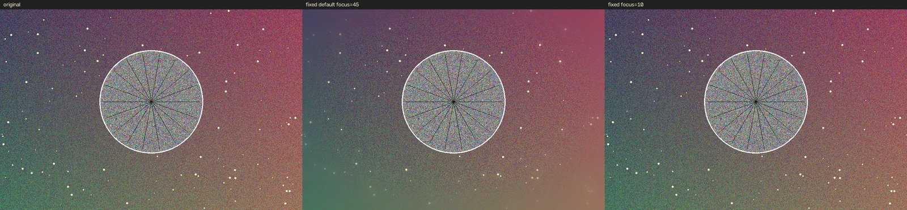

# 修复记录（2026-10-18）

> **目录调整（2026-10-19）**：源码已移至 `app/`，文档与图片在 `docs/`，模型缓存在 `models/`；下文中对旧路径的文字引用保留为历史记录。

## 2026-10-19 增量

- 背景虚化改为只在背景像素上做归一化卷积（clean plate），清晰主体的颜色不再被抹进背景，消除全图模糊的串色/光晕。
- 背景虚化从高斯改为按光圈形状 PSF 的 FFT 卷积（圆形/5–9 边形散景核），边缘高光和背景细节呈现真实散景轮廓。
- 光斑改为圆角多边形散景：圆形或 5–9 边形可选，密度可调，带柔边、亮边、猫眼压缩、偶发洋葱圈，并按前景掩膜遮挡；多个光斑改为加性叠加，重叠处变亮、混色。
- 移除“暖金光斑”选项；新增“光斑大小”30%–200% 调节。
- 光斑颜色改为参考背景环境色（排除高光和主体），避免白光源始终是纯白。
- 导出支持选择格式、分辨率、光斑抗锯齿（1×/2×/3×超采样）和 JPEG 质量；新增透明“大光圈效果图层”导出（RGBA PNG，主体区域透明）。
- 深度图增加常驻预览；导出目录增加可写性探测，沙箱或受保护目录自动回退到项目 `exports/`。
- UI 改为黄/黑/白配色。
- 性能（CPU，默认参数）：1000px 预览约 0.29 s，1400px 约 0.38 s，13.5MP 约 1.8 s，24MP 约 3.5 s（峰值约 2.6 GB）。

按 [代码检查报告.md](代码检查报告.md) 的顺序完成修复。源码改动集中在 `main.py`、`engine.py`、`depth_worker.py`、两个 `.bat`、两个 `requirements` 和 `README.md`，没有引入新依赖。

## 修复清单

| 编号 | 问题 | 修复方式 |
|---|---|---|
| P0-1 | 中文路径无法读/写图片 | 读取改用 Pillow（`Image.open` + `exif_transpose`），写出改用 `cv2.imencode` + `ndarray.tofile`；不再使用 `cv2.imread`/`cv2.imwrite`。同时补上 EXIF 方向处理 |
| P0-2 | 默认中心对焦把主体虚化 | `_make_coc` 增加单侧模式：中心模式改为“焦点半径内清晰、向外渐变虚化”，默认 focus=45 表示清晰半径；`_center_depth` 去掉无用的 `focus` 参数；AI 估算完成后自动按画面中部的中位深度设置焦点 |
| P0-3 | 全分辨率导出丢失 AI 深度 | 导出时把预览尺寸的深度图 `cv2.resize` 到原图尺寸再传给引擎；未生成深度时在导出完成对话框里明确提示 |
| P1-1 | 未打开图片点“显示原图”抛异常 | `self.processed` 在 `__init__` 初始化为 `None`；`toggle_original` 判空并回退到原图 |
| P1-2 | AI 运行中关闭窗口导致 fail-fast | 新增 `closeEvent`：提示后 `requestInterruption()`，等待 5 秒，仍未结束则 `terminate()`；测试退出码 0，不再出现 `QThread: Destroyed…` |
| P1-3 | “手动焦点”未实现 | `ImageCanvas` 增加 `clicked(x, y)` 信号和坐标映射；点击后按该点深度设置焦点并切到手动模式；有 AI 深度用 AI 深度，没有则用径向深度 |
| P1-4 | 滑块拖动卡顿 | 滑块/光圈改为 90 ms 单次防抖；引擎降低光斑计算分辨率、跳过全零模糊层，1000px 渲染约 0.21 s、1400px 约 0.37 s |
| P1-5 | 24MP 导出内存 4.1 GB | 模糊混合改为逐通道原地运算，去掉整幅 float 源图；光斑在高光低分辨率图上计算后再放大。24MP 峰值降到约 **2.25 GB**，耗时约 6.5 s |
| P1-6 | 暖金滑块实际是整体变暗 | 改成只对高光光斑做加性暖色叠加，暗部/整体亮度不变；光斑强度为 0 时暖金仍然生效 |
| P1-7 | AI 流程状态混乱 | pipeline 进程内缓存；每次任务带 generation，换图/换预览尺寸后旧结果自动丢弃；增加 `ai_hint` 状态文字；失败/过期/完成时按钮与提示同步；自动对焦 |
| P2 | 窗口过宽、高 DPI 发虚 | 画布最小宽度 480→360（最小窗口宽度 1289→1049）；pixmap 设置 `devicePixelRatio`，150% 缩放下 DPR=1.5；导出扩展名跟随文件过滤器；依赖加版本上限；启动脚本自动探测 Python 且只在缺依赖时安装；README 更新 |

## 实测回归

| 项目 | 修复前 | 修复后 |
|---|---|---|
| 默认中心对焦：主体清晰度 | 23.3% | **100%** |
| 默认中心对焦：背景清晰度 | 87.6%（环带） | **0.7%** |
| AI 焦点平面主体清晰度 | — | 98.3% |
| 暖金=100 时纯灰均值 | 107（暗 16%） | **128（不变）** |
| 1000px 预览渲染 | 181 ms | 约 205–217 ms |
| 1400px 预览渲染 | 375 ms | 约 367 ms |
| 3840px 预览渲染 | 2654 ms | 约 2417 ms |
| 24MP 导出耗时 | 8.0 s | 约 6.5–6.9 s |
| 24MP 峰值内存 | 4106 MB | **2253 MB** |
| 最小窗口宽度 | 1289 px | **1049 px** |
| 150% 缩放 pixmap DPR | 1.0 | **1.5** |

功能回归（`QT_QPA_PLATFORM=offscreen`，PySide6 6.12.0 / OpenCV 5.0.0.93 / Python 3.11.9）：

- 中文路径读取、中文目录+中文文件名导出、导出回读：通过
- EXIF 方向 6：60×40 → 40×60：通过
- 全分辨率导出收到的深度图形状 = 原图形状（2400×3840）：通过
- 未打开图片时连续切换“显示原图”：不再抛异常
- 快速拖动滑块：同步耗时 0–15 ms，防抖后只渲染一次
- 鼠标点击预览中心/右边缘：模式切到手动，焦点分别 5/99
- AI 运行中关闭：等待 5 秒后正常退出，退出码 0
- 缺少 torch 时点击 AI：给出可读提示，按钮恢复，hint 提示继续用中心对焦
- 过期的 AI 结果：按 generation 丢弃，不覆盖新图
- `run_windows.bat` 的解释器探测、复用 venv、跳过依赖安装分支：通过（用 junction 复用测试 venv 验证）

## 未覆盖的部分

- **AI 模型没有端到端跑通**：本机没有安装 torch/transformers（约 1 GB+），只验证了“缺依赖时的提示”、结果校验、自动对焦和缓存代码路径。首次真实推理仍建议在一台装好 `requirements-ai.txt` 的机器上跑一次。
- **CUDA 未测试**：本机无 NVIDIA GPU，所有数据来自 CPU。
- **真实显示器/缩放未测试**：高 DPI 只在 offscreen + `QT_SCALE_FACTOR=1.5` 下验证了 DPR，未做肉眼观感评估。
- **全新安装流程未跑完**：`run_windows.bat` 的 venv 创建/联网安装分支会下载约 150 MB，测试时用已有 venv 验证了探测与跳过安装的逻辑。
- 关闭时最多阻塞 5 秒再 `terminate()`；这是为了避免 Qt 的 fail-fast，不是原生的可取消推理。

## 修复后效果



左：原图；中：修复后的默认 focus=45（主体保持清晰，背景渐虚）；右：focus=10（清晰半径收窄，背景更强）。

## 运行方式

```powershell
run_windows.bat
```

首次运行会创建 `.venv` 并安装依赖。若之前已有 `.venv`，脚本会先做一次 `import PySide6, cv2, numpy, PIL` 检查，缺依赖时才联网安装。

检查用的临时 venv、wheel、测试脚本和截图已删除；项目目录只保留源码、说明、检查报告、修复记录和对焦对比图。
